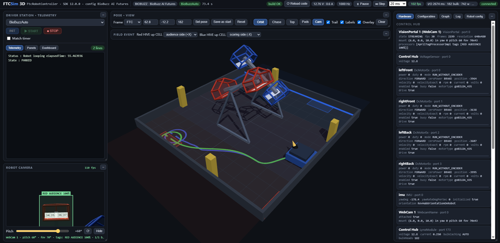

# FTCSim



A desktop simulator that runs **unmodified** FIRST Tech Challenge robot code. Point it at a
repository based on [FtcRobotController](https://github.com/FIRST-Tech-Challenge/FtcRobotController),
press INIT / START in the browser, and drive the simulated robot with a gamepad or the keyboard.

The screenshot above is the 3D view: the field and robot in three dimensions, the robot's camera
picture-in-picture in the lower left showing what the program actually sees — here the
`AprilTagProcessor` reporting RED AUDIENCE at 100% — with the hardware, telemetry and log panels
around it.

This is a fork of [WheatleyFromPortal2/FTCSim](https://github.com/WheatleyFromPortal2/FTCSim). That
project runs its first release on [this commit](https://github.com/WheatleyFromPortal2/FTCSim/commit/7ad0de4)
and the upstream has been quiet since, so this fork carries on from there. **The upstream README is the
reference for anything not listed under [What this fork adds](#what-this-fork-adds)** — the simulator
core, the hardware models and the configuration format are unchanged and are documented there in full.

The team code runs against the **real FTC SDK classes** (RobotCore, Hardware, FtcCommon, Vision,
downloaded from Maven Central in the version your repository declares). Only the pieces that talk to
real hardware or to Android are replaced by simulations.

## Requirements

* A JDK 17 or newer to build and run the simulator (JDK 21 is what it is developed with). You do not
  need it on your path — `gradle/gradle-daemon-jvm.properties` points the Gradle launcher at a JDK 21
  it finds on the machine or downloads from Adoptium.
* Network access to Maven Central the first time; everything is cached afterwards.
* A modern browser (Chrome, Edge, Firefox).

## Running

```bash
./gradlew run -Prepo=/path/to/your/FtcRobotController-based/repo
```

This compiles the team code in-process, starts the web UI and opens a browser. Sources are watched:
press **Reload code** after editing.

The repository is taken from the Gradle `-Prepo` property (or `--repo` if you run the simulator
main class directly). Other options:

```bash
./gradlew run -Prepo=../Decode --args="--port 9000 --no-browser"
./gradlew run -Prepo=../MyRepo --args="--config configs/MyRobot.json"
./gradlew run -Prepo=../MyRepo --args="--host 0.0.0.0"  # expose the UI to other machines (opt-in)
./gradlew run -Prepo=../MyRepo --args="--samples"      # also load the official sample OpModes
./gradlew run -Prepo=../MyRepo --args="--prebuilt"     # use classes Android Studio built (Kotlin projects)
```

Relative paths in `--config`, `--data` and `--web` are resolved against the repository root (the
`ftcsim.home` property, which the Gradle run sets for you), not against the working directory.
`--config configs/MyRobot.json` therefore works no matter where the simulator was started; if you
launch the main class yourself, set `-Dftcsim.home=<repo root>` to get the same behaviour.

The default team repository can also be set once in `ftcsim.properties` (committed here as
`repo=../FtcRobotController`): with that file present you can run `./gradlew run` and skip `-Prepo`.
If your team checkout lives somewhere else, edit that one line — the run fails with a message pointing
you back to `ftcsim.properties` if the path is wrong.

Team dependencies from the repository's Gradle files are resolved automatically; see the upstream
README for what that covers.

## The UI

The web UI listens on `127.0.0.1` only. Requests must be addressed to that host (`localhost` also
works), and WebSocket/API requests from another origin are refused, so a web page you happen to have
open cannot drive the robot and DNS rebinding cannot reach the port. `--host 0.0.0.0` (or a specific
LAN address) opts into network access; anyone who can reach the port can control the robot, so only
do that on a network you trust.

Two front ends ship side by side:

| URL | View |
|-----|------|
| `/` | **3D view** (default) — the field and robot in three dimensions, with the robot camera in a panel |
| `/2d/` | **2D view** — the original top-down interface |

Both carry the same Driver Station, hardware, telemetry, config and log panels, so only the field
rendering differs. The 2D view additionally has the two on-screen gamepads with their sticks and the
rumble indicator; the 3D view uses the physical controller directly.

The 2D view is a generic top-down map: it draws the obstacles and AprilTags in the field message and
the season option panel, but not season-specific structures such as the BIOBUZZ CELLs and HIVEs.
Those, and the robot camera panel, are drawn only in 3D.

| Keys | Gamepad |
|------|---------|
| W / S, A / D | left stick Y / X |
| Arrow keys | right stick |
| Q, E | left / right trigger |
| Z, X, C, V | A, B, X, Y |
| 1, 2 | left / right bumper |
| T, G, F, H | d-pad up / down / left / right |
| R, Backspace, Tab | start, back, guide |
| 3, 4 | left / right stick button |

## What this fork adds

### A 3D view with a picture-in-picture robot camera

`/` opens a Three.js view of the field: orbit, zoom and pan, the robot modelled with its wheels and
drivetrain, and — in the lower-left corner — a panel showing **what the robot's own camera sees**.

Drag the robot to move it, shift-drag or right-drag to turn it. The pose can also be typed into the
Pose / View panel and set with the FTC field, Pedro or code coordinate frame.

The camera pod is not a decoration: it is placed from the mount your team code declares on its
`WebcamName` device, including yaw, pitch and horizontal FOV, so the panel frames the field the way
the real camera does. Whatever your `AprilTagProcessor` detects is boxed on that view using the same
fiducial positions and camera mount the backend uses for its own results, so you can check detection
angles and IDs against what the program actually receives. A pitch slider takes over when no mount is
configured, and the status line says which of the two is in use.

### Mechanisms you declare in the configuration show up in 3D

A motor or servo that the robot configuration gives a `mount` to is drawn on the robot at that pose
and animated from the same 20 Hz device values the rest of the UI reads. A launcher flywheel spins
with its motor, an intake finger sweeps across its declared travel:

```json
{ "name": "launchLeft", "type": "DcMotorEx", "hub": "Expansion Hub", "port": 0,
  "params": {
    "mount": { "x": -6.5, "y": 7.6, "z": 8.0, "axis": "z", "shape": "cylinder" }
  } }
{ "name": "leftServo", "type": "Servo", "hub": "Expansion Hub", "port": 2,
  "params": {
    "mount": { "x": -8.0, "y": 5.0, "z": 6.2, "axis": "z", "shape": "box", "minDeg": 0, "maxDeg": 90 }
  } }
```

Robot frame: inches, `x` forward, `y` left, `z` up. `axis` is the robot axis the part turns about
(`z` for a wheel axle or an arm sweep, `x` for a roller). `minDeg`/`maxDeg` map a servo's 0..1
position onto its travel; leave them out and it is treated as a motor. `parent` nests a part under
another so it moves with it. **A device with no `mount` is not drawn** — absence is a statement,
and guessing a position would be worse than showing nothing.

Colour follows activity, the way the 2D view's power bars do: motors go green driving forward and
red backward, with brightness carrying power, and stay dark grey at rest. Servos brighten along gold
as they extend, because a servo's value is a position and colouring it red would wrongly imply it is
driving in reverse.

The chassis is translucent with an opaque outline, so mechanisms bolted inside the frame stay
visible without the robot turning into an abstract smudge. Its height and opacity are configuration
too (`heightIn`, `chassisOpacity`), as are the wheel positions, which now come from the `drivetrain`
block instead of fixed offsets.

### Gamepad rumble on the bound controller

`gamepad1.rumble(...)`, `rumbleBlips()` and `stopRumble()` used to be drained and dropped. They are
now drained from the OpMode's effect queues once per event loop pass, mirroring what
`FtcEventLoopHandler.gamepadEffects()` does on a robot, relayed over the WebSocket and replayed on the
controller bound to that gamepad through the browser Gamepad API. `large` / `small` map to the strong
and weak motors, a `duration` of −1 keeps the effect running until the next one or a stop, and the
2D gamepad shows a `rumble` badge so it is visible without a controller attached. LEDs are still not
forwarded — the browser Gamepad API has no LED support.

### Balls the robot launches are simulated, not animated

A robot configuration can describe a launcher, and the balls it fires are simulated on the field
rather than animated in the browser: gravity, bounces off the floor and the perimeter, rolling to a
stop, and a score when one reaches a goal — the DECODE goals or a BIOBUZZ CELL, whichever the field
has. They freeze with the pause button and advance with the step button, like everything else.

The launcher is declared on the device that drives it and describes the *shot*, not the mechanism,
so one block serves a double flywheel, a single-wheel shooter and a catapult alike:

```json
{ "name": "launchLeft", "type": "DcMotorEx", "hub": "Expansion Hub", "port": 0,
  "params": {
    "mount": { "x": -6.5, "y": 7.6, "z": 8.0, "axis": "z", "shape": "cylinder" },
    "launcher": {
      "exit": { "x": -4.5, "y": 0.0, "z": 8.0 },
      "speedFrom": "launchLeft",
      "wheelDiameterIn": 1.4,
      "slip": 0.85,
      "pitchDeg": 30,
      "capacity": 5,
      "salvoIntervalSec": 0.5,
      "trigger": { "servo": "leftServo", "position": 0.5, "minRpm": 1200 }
    }
  } }
```

`exit` is the muzzle in the robot frame (inches, x forward / y left / z up) and defaults to where
the part is mounted. A ball leaves at the wheel's surface speed, `omega x radius x slip`, along the
robot's forward direction raised by `pitchDeg`; `speedInPerSec` replaces that with a fixed speed.
`ballRadiusIn` is the ball's radius — a BIOBUZZ POLLEN is 2.8 in across, so 1.4 — and `ballMassG` is
its mass in grams. Gravity treats every ball alike, so the mass only ever shows up as air drag, and
it shows up plainly: a light ball falls well short of a heavy one of the same size. Leave
`ballMassG` out and drag is a plain linear damping instead.
The team's code is never modified and the SDK has no "I fired" call, so a shot is *inferred*: either
`trigger.servo` reaching `position` — a servo ramps rather than jumps, so this is a level crossing
with `deltaPosition` of hysteresis — or, when no servo is named, the flywheel reaching `minRpm`.
Set `minRpm` near the speed the wheel actually turns at when it fires: trigger too early and the
ball is thrown while the wheel is still spinning up, at a fraction of the speed it should have.

One trigger event fires the **whole magazine as a salvo** — every ball leaves, spaced `salvoIntervalSec`
seconds apart (default 0.5), so a shot reads as a stream of balls rather than one. There is no
auto-reload zone: the magazine refills on a match reset (INIT / `robot.restart`), or when the robot
drives over a ball resting on the floor, which is picked back up. The 3D view draws the carried balls
**inside the translucent chassis** instead of a text count, so the remaining ammunition is visible at a
glance.

The launch angle is not fixed either: the **Pitch** slider in the launcher's own row aims it live,
so the shot can be swept without touching the configuration — `pitchDeg` is only where the slider
starts. (The camera panel's pitch slider is the camera's alone.)

### Fixes

* **Hub timing on Windows.** `LockSupport.parkNanos` rounds every request up to the 15.6 ms scheduler
  tick there, so parking the first millisecond of a 2.5 ms hub write actually cost 15 ms and every
  OpMode ran about six times slower than on a real robot. Waits now sleep in whole milliseconds and
  spin the last 1.5 ms, which is what it takes to keep the latency emulation honest on Windows.
* **The UI could wedge silently and only a restart fixed it.** The state broadcast ran on one thread
  and wrote to every connected client inline under a lock, so a browser tab that stopped reading —
  reloading the page, or switching from the 2D view to the 3D one — filled a TCP send buffer and
  blocked the write forever. Every other client then stopped receiving state, with nothing in the
  console and nothing in the server log. Each client now has its own writer thread behind a bounded
  queue: sending never blocks, a client that keeps dropping frames is disconnected, and closing a
  client shuts its socket down first, which is what releases a stuck writer.
* **Device settings in the shipped configurations were silently ignored.** `RobotConfig.Device` reads
  everything except `name`, `type`, `hub` and `port` out of a nested `params` object, but
  `configs/Biobuzz.json` wrote `motorType`, `mount` and the Pinpoint `xPod`/`yPod` at the device
  level, where Gson drops them without complaint. Every motor ran on the wrong characteristics and
  the odometry pods used no offset at all. The same file also had no `drivetrain` block in
  `configs/FtcRobotController.json`, so that robot ran on the default 3.78 in wheels and 14 × 12 in
  geometry whatever it was actually built with.

## Tests

```bash
./gradlew test                                           # unit tests plus the WebSocket protocol test
node tools/check-web.mjs                                 # parse the web modules
node tools/docs-check.mjs --check                        # fail if a documented code reference drifted
node tools/wsclient.mjs 8000 BlueTeleOp 4                # drive an OpMode over the WebSocket API
node tools/run-all.mjs 8000 4                            # init/start/stop every OpMode
node tools/verify-3d-probe.mjs                           # what the 3D page built, and where
```

`./gradlew test` includes `SimulatorProtocolTest`, which starts the simulator in a child JVM with a
temporary BIOBUZZ config, so it needs no team repository (the missing-repo path is what CI uses). It
checks the `hello` field description, an option change, and a reset over the real WebSocket protocol.

The `verify-*` scripts drive the real page in headless Chrome and assert on what it draws: the
declared parts and their poses, the colour encoding, the chassis geometry, and the launcher firing
end to end from the team's TeleOp. They locate Chrome through `$FTCSIM_CHROME` (or the platform
default) and write screenshots to `build/`, so they need no npm install. Run them against a server
already started with `./gradlew run`.

The Playwright-driven tests do need a local install:

```bash
npm install
npx playwright install chromium
node tools/ui-field-test.mjs 8000 biobuzz   # 3D + 2D against a BIOBUZZ simulator
node tools/ui-field-test.mjs 8000 decode    # the same against a DECODE one
node tools/ui-test.mjs 8000 BlueTeleOp      # drive a TeleOp through the page
```

`ui-field-test.mjs` selects season options in both views and checks that the choice reaches the
backend and comes back to the rendering; in biobuzz mode it also checks the CELL/HIVE layout and the
HIVE swing, in decode mode the visible obelisk face. It writes screenshots to `build/ui-field/`.

## License

FTCSim is available under the [MIT License](LICENSE). It is a fork of
[WheatleyFromPortal2/FTCSim](https://github.com/WheatleyFromPortal2/FTCSim); the upstream project
declares no license of its own, and its attribution is preserved above.

Third-party components keep their own licenses. The FTC SDK, Three.js, OpenCV/EasyOpenCV/AprilTag,
Gson, Kotlin and JSON-java are redistributed or loaded under the terms listed in
[THIRD_PARTY_NOTICES.md](THIRD_PARTY_NOTICES.md); full texts are in [`licenses/`](licenses/).

## Layout

* `sim/` — the simulator: physics (`ftcsim.physics`), hardware models (`ftcsim.hardware`), OpMode
  runner (`com.qualcomm.robotcore.eventloop.opmode.SimOpModeRunner`), team code compiler
  (`ftcsim.teamcode`), web server (`ftcsim.web`), vision (`ftcsim.vision`).
* `sim/src/main/resources/web/3d/` — the 3D view and the robot camera panel.
* `sim/src/main/resources/web/2d/` — the original 2D view.
* `android-compat/`, `ftc-sdk/` — the SDK desktop jar and the `android.*` shims.
* `configs/` — robot configurations, one per repository, named after its folder.

The configuration format, the device models and the simulator core are documented in the
[upstream README](https://github.com/WheatleyFromPortal2/FTCSim/blob/main/README.md); `configs/Decode.json`
is a complete example.
