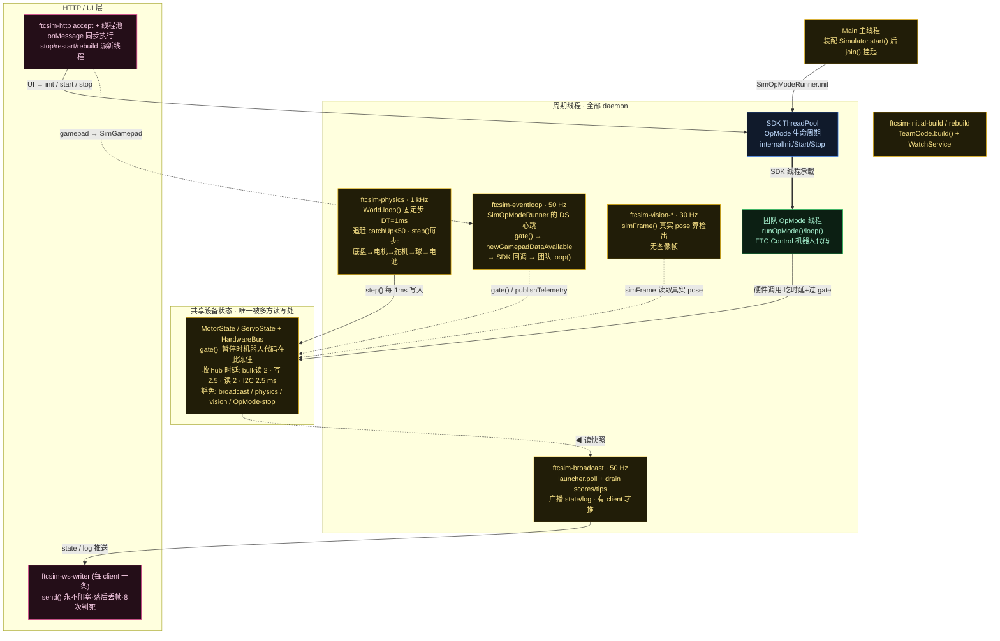

# FTCSim 进程内线程拓扑（Phase 1 · 第 1 步：总览梳理）

配色按代码归属：**黄 = 模拟器实现**（ftcsim.*，含挂在 SDK 包名下的 shadow）· **蓝 = 真 SDK** · **绿 = 团队代码**（FTC Control 机器人代码）· 粉 = Web 出口。

核心问题「tick 是谁在推」的答案：只有 `ftcsim-physics` 一条线在推（1 kHz 固定步），其余线程全是观察者/消费者。

源码证据见 `notes/research/sim-physics-research-notes.md`。
