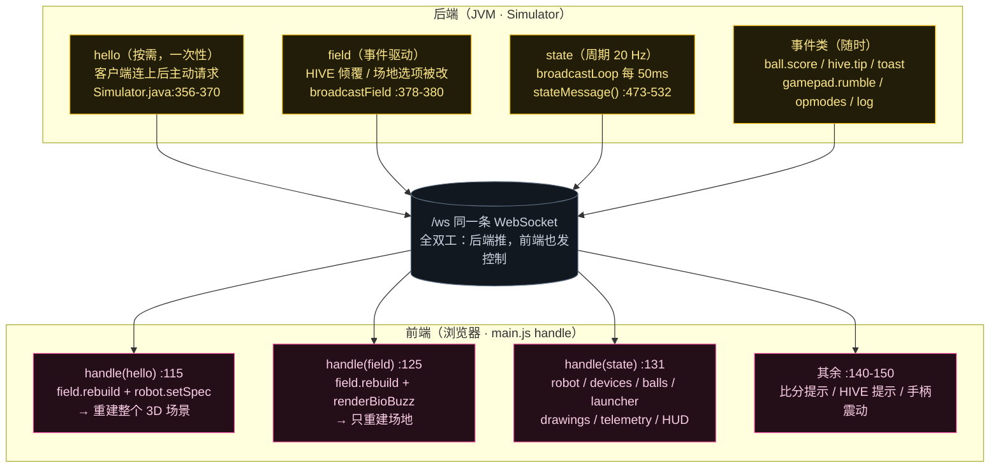
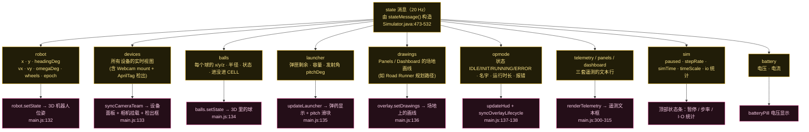
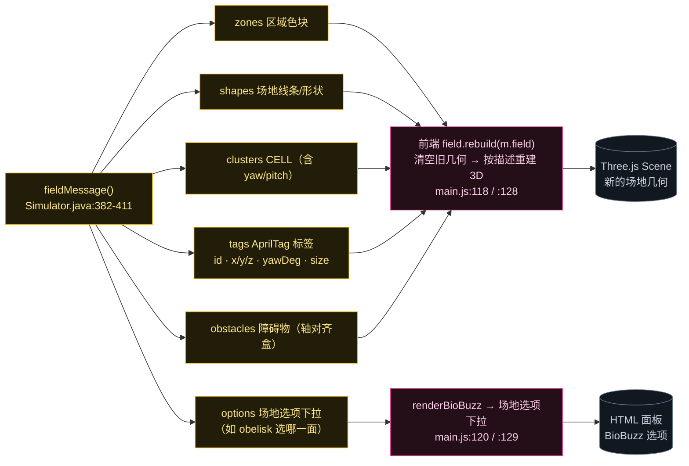
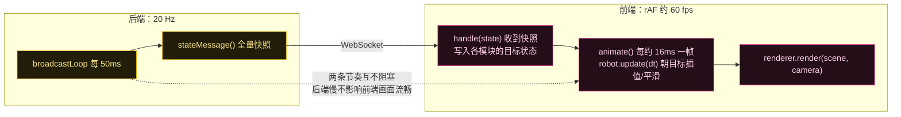

# WebSocket 消息如何驱动 3D（Phase 2 · 第 1 步）

一句话：**后端每隔 50 ms 把整个世界"拍一张全量快照"发给前端，前端收到后直接覆盖各模块的目标状态，再用自己的 `requestAnimationFrame` 插值画出来**。后端只管发，前端只管画，两边通过一条 `/ws` 连接单向流动。

---

## 图 1：消息全景——谁在什么时候发什么



**三种不同的触发节奏**（这是理解整个前端的钥匙）：

| 消息 | 节奏 | 触发条件 | 体量 |
|---|---|---|---|
| `hello` | **按需一次** | 前端连上后发 `{type:"hello"}`，后端回应（:309） | 大：整个场地 + 机器人规格 + 起始位姿 |
| `field` | **事件驱动** | HIVE 倾覆使 CELL 移动、或场地选项被改 | 大：整份场地描述 |
| `state` | **周期 20 Hz** | broadcastLoop 每 50 ms（:625） | 中：全量快照，每次都重发所有设备/球/遥测 |
| `log` / `toast` / `ball.score` / `hive.tip` | 事件 | 随时 | 小 |

> `hello` 之后后端还会**紧跟着单独发一条 `opmodes`**（:368），所以 OpMode 下拉列表不用等下一次 state。

---

## 图 2：`state` 消息的字段 → 分别驱动前端哪个模块（本步核心图）

`state` 是**全量快照**：不管有没有变化，每次都把所有东西发一遍。所以前端不需要维护状态机，收到就直接覆盖。



**两个必须记住的单位约定**（后端在 `stateMessage()` 里就转好了）：

- 位置：`robot.x / y` 已经是**英寸**——后端物理内部是**米**，发送前用 `Units.mToIn(...)` 换算（:481-482）；
- 角度：`headingDeg / omegaDeg` 是**度**（后端内部是弧度，发送前 `Math.toDegrees(...)`）。

也就是说：**后端负责把物理单位翻译成"前端好画"的单位**，前端拿到的直接就是英寸和度，不用再做换算。

---

## 图 3：`hello` / `field` 如何重建 3D 场景

`hello` 是唯一的"建场"消息。它携带的 `fieldMessage()`（:382-411）是一份完整的场地描述：



同时 `hello` 里的 `robot`（机器人规格）+ `startPose` 交给 `robot.setSpec(...)`（:119）——**零件怎么摆、初始位姿在哪，都是这条消息决定的**（第 3 步研究过的 `DeviceMount` 就在这里起作用，后续第 3 小步会展开）。

`hello` 还会顺手 `clearTrail()` 和 `balls.clear()`（:122-123）——**新连接 = 新的一场**，轨迹和球都要清掉。

---

## 图 4：两条独立的时钟——20 Hz 推送 vs 60 fps 渲染

这是"驱动"最微妙的地方，也是你在屏幕上看到的运动是**平滑的**而不是**一顿一顿**的原因。



**类比**：后端 20 Hz 推送 ≈ 服务端每 50 ms 告诉你"目标位置在这"；前端 60 fps 渲染 ≈ 你用 rAF 做补间动画把物体平滑移过去。这和你做过的"服务端推数据 + 前端补间"**完全同构**。

所以：`robot.setState()` 只是**设定目标**，`robot.update(dt)` 才负责**平滑地走过去**（`main.js:528`）。如果你看到机器人移动有"黏滞感"，那是插值系数的问题，不是后端 tick 慢。

---

## 一个真实的前后端协同细节（值得单独讲）

`state` 里的 `drawings`（场地画线，如 Road Runner 的规划路径）在后端有 **3 秒新鲜度限制**：

```java
// Simulator.java:499-502
if (pd != null && System.currentTimeMillis() - pd.time < 3000) drawings.add(...);
if (dd != null && System.currentTimeMillis() - dd.time < 3000) drawings.add(...);
```

后果：**团队代码停止画线 3 秒后，后端就不再广播这条路径**——早期版本里这导致路径在比赛中途"闪一下就没了"。于是前端改成 **sticky 策略**（`main.js:258-268`）：自己记住画线不主动过期，只在**加载新 OpMode / 点 Clear / 重启机器人**这三个时机才清。

> 这是典型的"后端语义不够用，前端补一层策略"的协同案例。再遇到类似"UI 上东西莫名消失"的问题，第一反应应该是查后端广播的新鲜度/生命周期条件。

## 源码证据

**后端（JVM）**
- `Simulator.java:309`（收到前端 hello 请求）、`356-370`（sendHello：field + robot + startPose + 紧跟 opmodes）
- `Simulator.java:378-380`（broadcastField）、`382-411`（fieldMessage：zones/shapes/clusters/options/tags/obstacles）
- `Simulator.java:473-532`（stateMessage：robot/devices/balls/launcher/drawings/telemetry/sim/battery/drivetrain/codeFrame）
- `Simulator.java:611-652`（broadcastLoop 20 Hz）、`:625`（广播 state）

**前端（浏览器）**
- `main.js:103-110`（connect / send，同一条 `/ws`）
- `main.js:112-151`（handle：hello / field / state / opmodes / toast 等分支）
- `main.js:131-139`（state 各字段的分发）
- `main.js:258-268`（overlay 的 sticky 生命周期策略）
- `main.js:524-553`（animate 渲染循环与插值）
