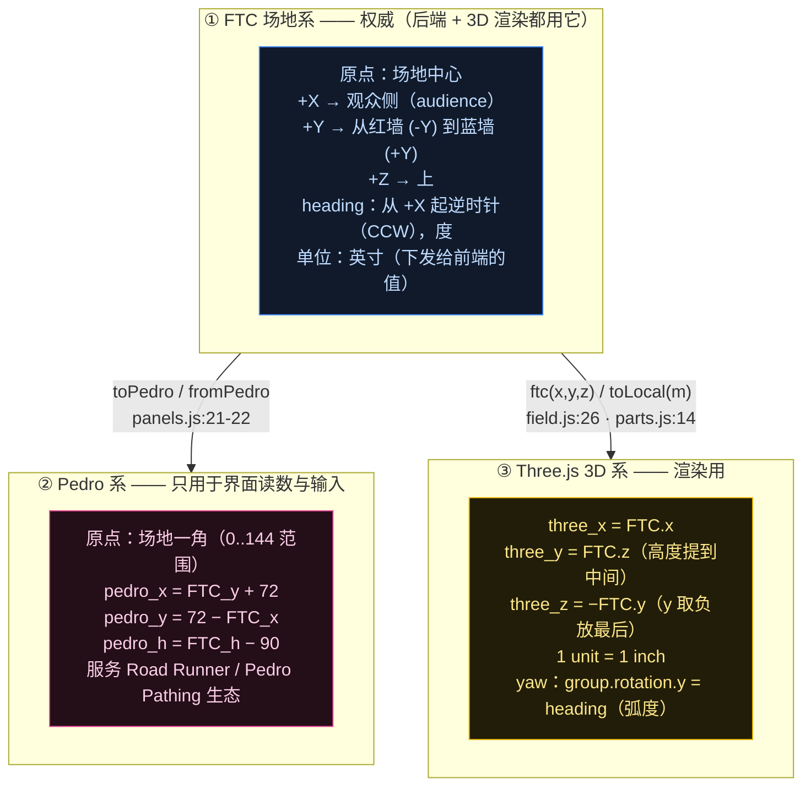
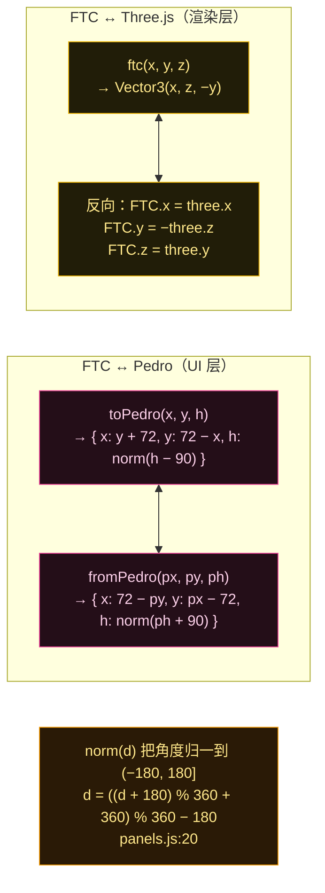
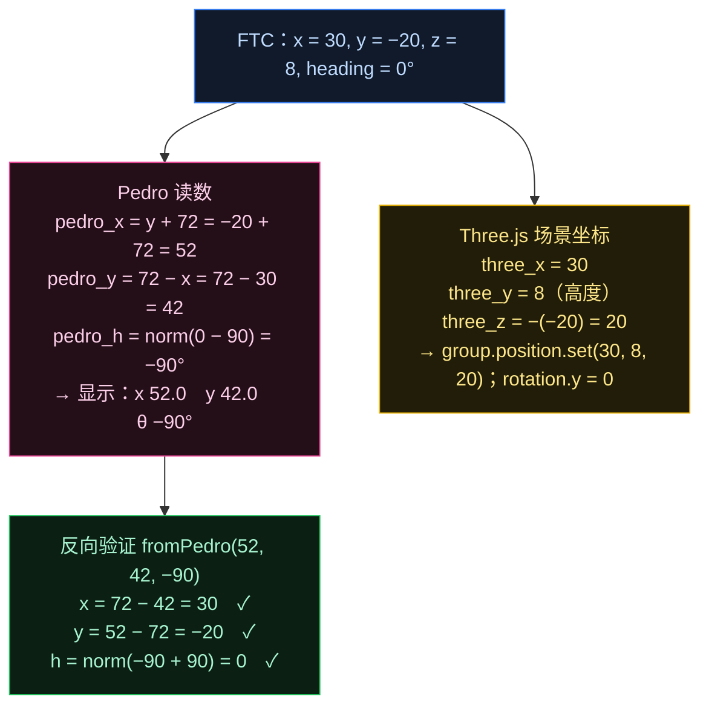
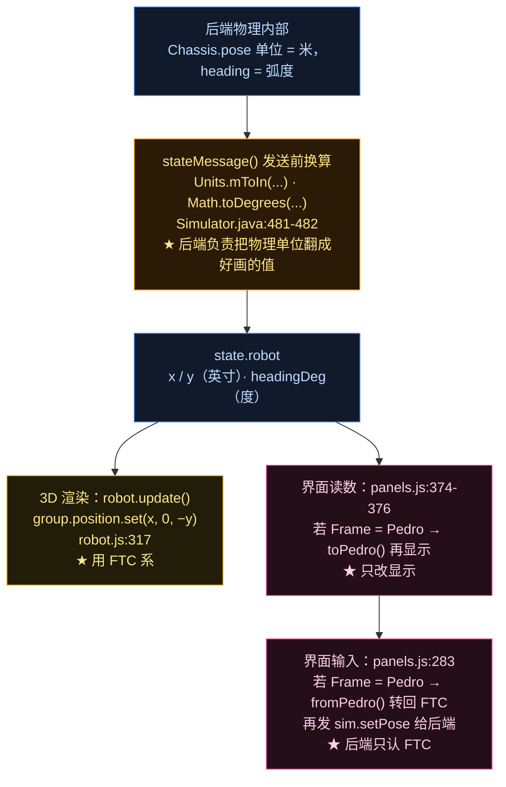
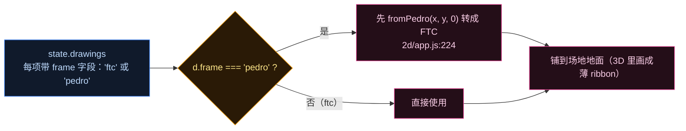

# 三套坐标系总图（Phase 2 · 第 5 步 · 收官）

项目里同时存在**三套坐标系**。这篇把它们放在一起，给出完整换算、数值演算，以及**换算分别发生在哪一步**。

先给一个关键结论，帮你少走弯路：

> **Pedro 系只存在于 UI 的读数/输入框里。** 后端权威数据、3D 场景里机器人的实际位置，**始终都是 FTC 系**。切换界面上的 Frame 选择器，只改变那三个输入框显示的数值，机器人该在哪还在哪。

---

## 图 1：三套坐标系各是什么

注意 **FTC → 3D** 与 **机器人局部帧 → 3D** 用的是同一条规则（x 不变、z 提到中间当高度、y 取负），只是前者是全场坐标、后者是机器人局部坐标。

---

## 图 2：全部换算公式（含反向）

---

## 图 3：一个具体的数值演算（照着算一遍最不容易忘）

假设机器人在 **FTC 系**里位于 `x = 30, y = −20`，朝向 `heading = 0°`（朝 +X，即观众侧），离地高度 `z = 8`。

**一句话记忆**：Pedro 是"把场地摊成 0..144 的第一象限"（所以 x、y 都要 ±72 平移再互换），3D 是"把 z 抽出来当高度、y 取负"（所以 `ftc = (x, z, −y)`）。

---

## 图 4：换算分别发生在数据流的哪一步

**关键**：后端下发前就把米→英寸、弧度→度做完了。所以前端拿到的 `state.robot` **直接就是 FTC 系的英寸和度**，不需要再换算单位——只需要做轴向映射（FTC→3D）或读数换算（FTC→Pedro）。

---

## 图 5：一个容易漏掉的地方——drawings 自带坐标系标记

场地上画出的那些线（Road Runner 规划路径、Pedro Pathing 图形、Panels 形状）是通过 `state.drawings` 下发的，**它们自己也带坐标系标记**：

因为团队可能用 **Pedro Pathing** 画图（那套坐标系是 Pedro），也可能用 **Road Runner / FTC Dashboard**（FTC 系）。所以前端必须看 `frame` 字段决定要不要转换，否则路径会画在错误的位置。

---

## 速查卡

| 你手上有什么 | 想要什么 | 怎么做 |
|---|---|---|
| FTC (x, y, h) | 界面显示 Pedro | `toPedro`：`(y+72, 72−x, norm(h−90))` |
| 界面输入的 Pedro | 发给后端的 FTC | `fromPedro`：`(72−py, px−72, norm(ph+90))` |
| FTC (x, y, z) | 摆到 3D 场景 | `ftc`：`Vector3(x, z, −y)` |
| 机器人局部 mount (x, y, z) | 摆到机器人上 | `toLocal`：`Vector3(m.x, m.z, −m.y)` |
| 3D 场景坐标 | 反推 FTC | `x = three.x`，`y = −three.z`，`z = three.y` |
| 后端物理值 | 前端收到的值 | 后端已转好：米→英寸、弧度→度 |

## 源码证据

- FTC 场地系定义：`Field.java:10-12`（原点/+X 观众侧/+Y 红→蓝/+Z 上/CCW heading，英寸）
- 后端单位换算：`Simulator.java:481-482`（`Units.mToIn`、`Math.toDegrees`）
- Pedro 换算：`web/3d/panels.js:20-22`（`norm` / `toPedro` / `fromPedro`）、`:283`（输入转回 FTC）、`:320-325` 与 `:374-376`（显示切换）；2D 同款 `web/2d/app.js:119-120`
- FTC → 3D：`web/3d/field.js:26`（`ftc`）、`web/3d/parts.js:14-16`（`toLocal`）
- 3D 摆位与 yaw：`web/3d/robot.js:317-318`（`group.position.set(x, 0, -y)`、`rotation.y = h`）
- drawings 的 frame：`web/2d/app.js:224`（按 `d.frame` 决定是否 fromPedro）
- 项目约定：根 `CLAUDE.md`（Frames 段：Pedro 换算与 tag 四元数约定）
