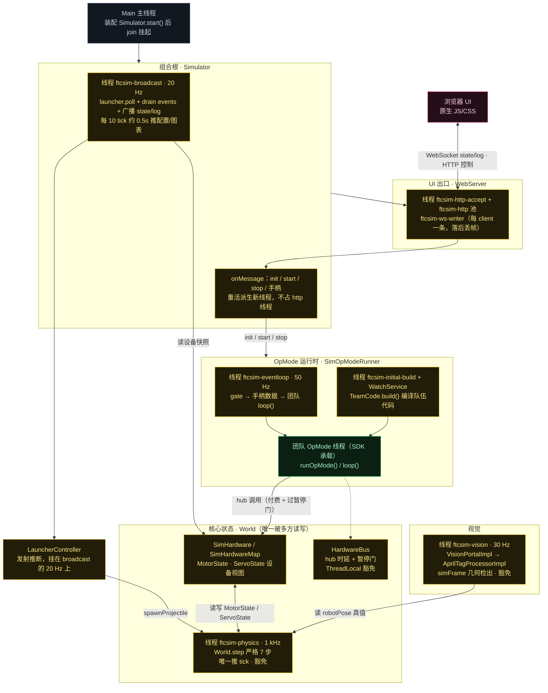
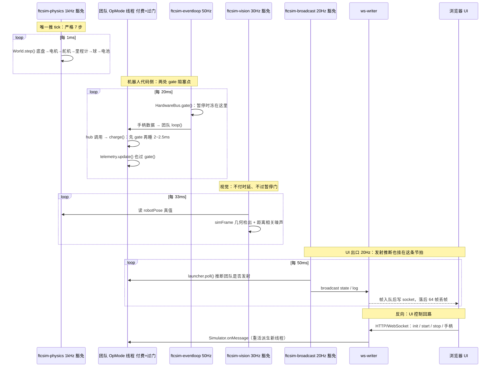

# FTCSim Phase 1 总览（第 7 步：结构图 + 时序图）

Phase 1「物理模拟是怎么实现的」到此收官。本文两张图：**图 1 = 模块 + 线程拓扑结构图**，**图 2 = 一个 tick（含各线程不同频率）的时序与阻塞图**。

配色：**黄 = 模拟器实现**（含挂在 SDK 包名下的 shadow）· **绿 = 团队代码** · **粉 = Web/UI 出口** · **灰 = 核心物理与启动入口**。

## 图 1：模块 + 线程拓扑结构图

## 图 2：一个 tick 的时序与阻塞关系（各线程频率不同）

## 频率总表（已修正）

| 动作 | 频率 | 节拍来源 | 备注 |
|---|---|---|---|
| `World.step` 推进世界 | **1 kHz**（`DT=0.001`） | `ftcsim-physics` 自锁 `next += DT/timeScale` | 追赶上限 50 步，落后则重锚定 |
| 团队 `loop()` 驱动 | **50 Hz**（20 ms） | `ftcsim-eventloop`，`next += 20_000_000L` | 注释："像 DS 的手柄包" |
| 发射推断 `launcher.poll()` | **20 Hz**（50 ms） | `ftcsim-broadcast` 里被调用 | 第 4 步的"推断"就挂在这 |
| 视觉 `simFrame` | **30 Hz**（33.3 ms） | `ftcsim-vision-<camera>` | 与 `FPS=30` 一致 |
| UI 广播 `state`/`log` | **20 Hz**（50 ms） | `ftcsim-broadcast`，`next += 50_000_000L` | 仅在有 client 时广播 |
| `configurables`/`graphs` | 约 **2 Hz** | broadcast 里每 10 tick | 即每 0.5 s 一次 |

> **修正**：第 1 步笔记曾把 `ftcsim-broadcast` 记作 50 Hz，实际 `50_000_000L` ns = **50 ms = 20 Hz**（`launcher.poll()` 的注释也印证是 20 Hz）。50 Hz 的是 `ftcsim-eventloop`。
> 一句话：**50 Hz 的 `eventloop` 驱动团队 `loop()`；20 Hz 的 `broadcast` 驱动 UI 广播与发射推断。**

## 阻塞 / 付费速查表（第 5 步的浓缩）

| 线程 | 付 hub 时延 | 过暂停门 | 阻塞发生在哪 |
|---|---|---|---|
| 团队 OpMode 线程 | ✅ | ✅ | 每次 hub 调用 `charge()`（先 gate 再睡 2~2.5ms）；`publishTelemetry` |
| `ftcsim-eventloop` | — | ✅ | 每次 pass 开头 `gate()` |
| `ftcsim-physics` | ❌ 豁免 | ❌ | 自己判 `frozen()` 自停：`if(frozen()) sleep(5)` |
| `ftcsim-vision-*` | ❌ 豁免 | ❌ | 不阻塞（但 pose 冻结时结果恒定） |
| `ftcsim-broadcast` | ❌ 豁免 | ❌ | 不阻塞，读设备直连 `MotorState` |
| `ftcsim-internalStop` 等 stop 线程 | ❌ 豁免 | ❌ | 必须豁免，否则暂停时 OpMode 停不掉 |

> 一句话：**只有团队代码线程会付费、会被冻**；模拟器自己的线程一律豁免，直读同一份状态。

## Phase 1 成果索引

| 图 | 文件 | 对应步骤 |
|---|---|---|
| 进程内线程拓扑 | `docs/architecture/01-threads.md` | 第 1 步 总览梳理 |
| 电机信号链 | `docs/physics/01-motor-signal-chain.md` | 第 2 步 |
| 传感器模型 | `docs/physics/02-sensor-model.md` | 第 3 步 |
| 物理积分与世界 | `docs/physics/03-world-physics.md` | 第 4 步 |
| 真实感三件套 | `docs/physics/04-hub-timing-gate.md` | 第 5 步 |
| Vision | `docs/vision/01-vision.md` | 第 6 步 |
| **总览：结构图 + 时序图** | **`docs/architecture/04-phase1-overview.md`** | **第 7 步** |

完整结论见研究笔记 `notes/research/sim-physics-research-notes.md`（结论 1–27）。

## 源码证据

- 线程与频率：`Simulator.java:130`（broadcast 起线程）、`:611-652`（broadcastLoop 20 Hz）、`SimOpModeRunner.java:293-321`（eventLoop 50 Hz）、`VisionPortalImpl.java:32,78-95`（FPS 30）、`World.java:17,285-319`（DT 1 kHz）
- 阻塞与豁免：`HardwareBus.java:73-94`（charge/gate）、`LynxModule.java:120-147`（bulkRead 三条路径）、`SimOpModeRunner.java:186,303,347`（stop 豁免与两处 gate）
- 结构与装配：`Main.java:9-38`、`Simulator.java:77-134`
