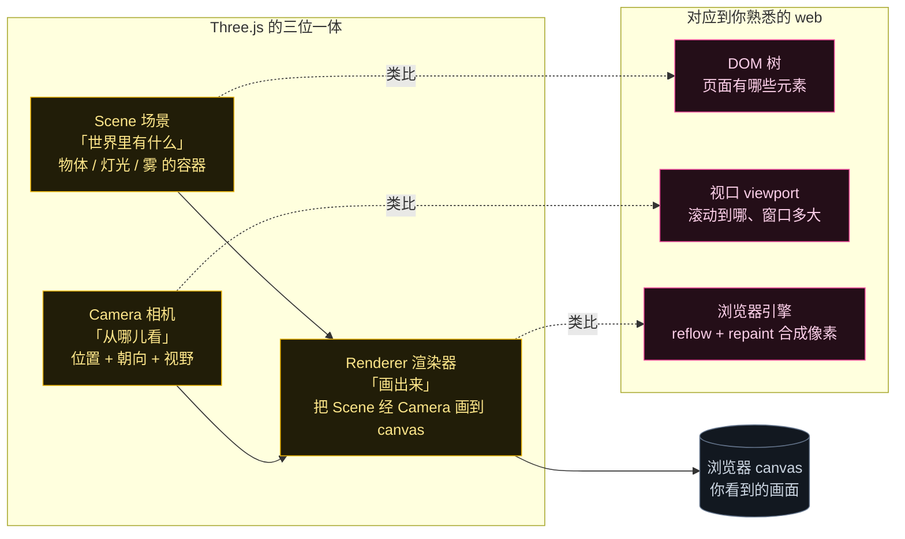
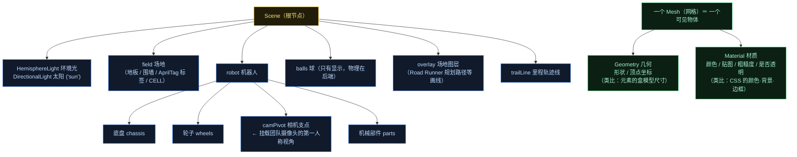
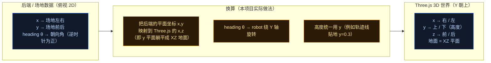
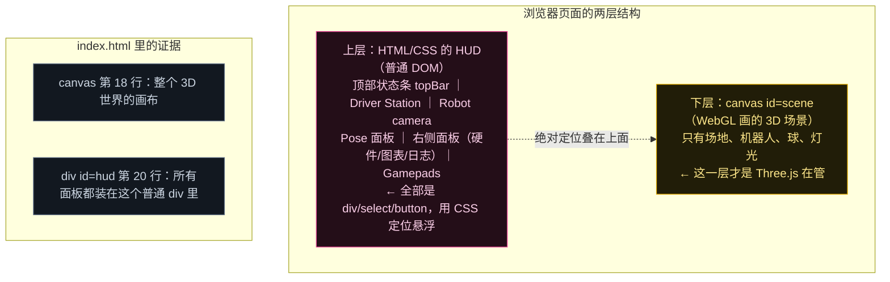
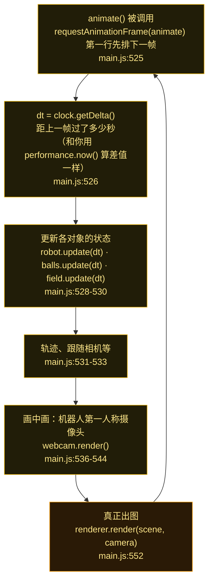

# Three.js 零基础入门（Phase 2 准备篇 · 用 web 概念做类比）

> 目标：让你完全不懂 3D 也能看懂本项目的 3D 前端。所有概念都用你熟悉的 **DOM / CSS / requestAnimationFrame** 做类比，并标出**本项目代码里的真实位置**（`web/3d/main.js` 与 `index.html` 行号），不是空泛科普。

Three.js 本质上只做一件事：**在一块 `<canvas>` 上，用一个虚拟相机把一堆 3D 物体画出来**。其余都是围绕这件事的组织方式。

---

## 图 1：Three.js 的「三位一体」——Scene / Camera / Renderer

这是最核心的一张图。Three.js 任何程序都少不了这三样。



**本项目里的对应代码**（`web/3d/main.js`）：

| 角色 | 代码 | 含义 |
|---|---|---|
| Renderer | `new THREE.WebGLRenderer({ canvas, antialias: true })`（:21） | 绑定到 `index.html` 里那块 `<canvas id="scene">`（:18） |
| Scene | `new THREE.Scene()`（:26），`scene.background`、`scene.fog`（:27-28） | 背景色 + 雾 |
| Camera | `new THREE.PerspectiveCamera(50, 1, 0.5, 2000)`（:30） | `50` = 视野角度 FOV；`0.5/2000` = 最近/最远可见距离 |
| **出图** | `renderer.render(scene, camera)`（:552） | 每帧调一次，画面就更新一次 |

> 一句话记牢：**Scene 是内容，Camera 是视角，Renderer 是画笔**，`render(scene, camera)` 就是那一下落笔。

---

## 图 2：Scene Graph（场景图）—— 物体怎么组织，Mesh 又是什么

Scene 里不是平铺一堆东西，而是一棵**树**（和 DOM 一模一样）。父子之间会**继承变换**（移动/旋转/缩放），这点也和 CSS 嵌套 transform 同构。



**关键概念 Mesh = Geometry + Material**（这是小白最容易卡住的地方）：

- **Geometry（几何）**＝形状本身。类比「元素的盒模型/width+height」：一块地板是一个扁盒子，轮子是圆柱。
- **Material（材质）**＝外观。类比「CSS：颜色、背景图、边框、opacity」。
- 两者合起来才是屏幕上看得见的 **Mesh**。
- 项目里的现实例子：轨迹线 `new THREE.Line(trailGeom, new THREE.LineBasicMaterial({ color: 0x8fb8ff, opacity: 0.85 }))`（`main.js:77`）——前面是几何，后面是材质，一目了然。

还有个 web 味道很重的点：**顶点数据是 typed array**。`BufferGeometry` + `Float32Array`（`main.js:72-75`）就像你把像素塞进 `ImageData` 再交给 Canvas——**先把数据准备好，再一次性交给 GPU**，而不是每帧创建对象。这是 3D 里最常见的性能写法。

> ⚠️ **一个反直觉的点**：3D 里**没有灯就一片漆黑**（如果你用对光有反应的材质）。这就是 `main.js:42-51` 必须先加 `HemisphereLight` + `DirectionalLight` 的原因——相当于给房间先装灯，再放家具。

---

## 图 3：坐标系（本项目最容易踩的坑）

Three.js 的默认世界是 **Y 轴朝上**（up = +Y），地面是 **XZ 平面**。而我们的物理/场地数据是另一套约定。这一张图务必看懂。



**代码证据**：`main.js:89` 写轨迹点时是这么落的——

```js
trailPos[trailLen * 3]     = p.x;      // x → x
trailPos[trailLen * 3 + 1] = 0.3;      // 高度恒为贴地的 0.3
trailPos[trailLen * 3 + 2] = p.z;      // 平面的另一个轴 → z
```

**注意中间那个分量是固定高度 `0.3`，而第三个分量用的是 `p.z`**——这直接证明：本项目把后端的**平面** (x, y) 铺到了 Three.js 的 **XZ 地面**，把 **y 让给了高度**。看到任何 `(x, y, z)` 的代码时，先在脑子里做这个替换，就不容易晕。

> 另一条线索：`index.html:103` 有 `Frame <select>` 可选 **FTC / Pedro** 两种坐标显示；Pedro 系的换算是 `pedro_x = FTC_y + 72`、`pedro_y = 72 - FTC_x`、`FTC_heading = pedro_heading + 90°`（见根 `CLAUDE.md`）。**三套坐标系**共存：物理后端一套、Pedro 一套、3D 渲染一套。这是 Phase 2 后续要专门画图理清的重点。

---

## 图 4：页面是两层——3D 画布在下，HTML 面板浮在上

很多新手以为屏幕上那些按钮/面板也是 3D 画的。其实不是：**3D 只负责那一块 canvas，UI 全是普通 HTML/CSS 浮在上面**。



好处在于：**UI 你完全不用学 3D**——面板还是你熟悉的 `position: absolute` + flexbox + 事件监听（比如 `$('startBtn').onclick = () => send({ type: 'opmode.start' })`，`main.js:196`）。真正的分工是：

- **3D 层**：只管把「世界长什么样」画出来；
- **HTML 层**：负责所有交互控件，点击后通过 WebSocket 发消息给后端。

---

## 图 5：每一帧发生了什么（渲染循环）

Three.js 的动画循环就是浏览器原生的 **`requestAnimationFrame`**——这一点你完全熟悉，没有任何新东西。



**两个要点**：

1. **后端推数据（20 Hz）与前端画帧（通常 60 fps）是两条独立的节奏**。后端每 50 ms 来一个 `state` 消息更新目标状态，前端则在自己的每一帧里做插值/平滑。所以你在屏幕上看到的机器人移动是**被插值过**的，不是后端那一帧一帧的跳变。这和"服务端推送 + 前端 rAF 补间动画"完全同构。
2. **本项目有第二个相机**：`webcam.render()` 时用另一个挂在机器人上的 `PerspectiveCamera` 再画一遍同一个 Scene，输出到面板里那块小 `<canvas id="camCanvas">`（`main.js:410-415`、`:536`）。**同一个 Scene 可以被任意多个相机渲染多次**——这是画中画的实现方式，也是"低成本地让机器人视角和 AprilTag 检出框同屏"的技巧。

---

## 术语速查表（左：3D 概念 → 右：你熟悉的 web 类比）

| Three.js 概念 | 类比 | 本项目位置 |
|---|---|---|
| `Scene` | DOM 树（容器） | `main.js:26` |
| `Object3D` / `Mesh` | `HTMLElement`（一个节点） | 各处 add |
| `Geometry` | 盒模型尺寸 / SVG path（形状） | 轨迹 `line 74-75` |
| `Material` | CSS 颜色·背景·边框（外观） | `line 77` |
| `Texture` | `background-image`（贴图） | 场地/部件里用 |
| `Light` | 必须有，否则物体全黑 | `line 42-51` |
| `PerspectiveCamera` | 视口 + FOV + 近远裁剪面 | `line 30` |
| `position / rotation / scale` | `transform: translate/rotate/scale` | `line 31`、`line 449` |
| `Vector3` | `{x, y, z}`，类似 `translate3d(x,y,z)` | `line 506,511` |
| `BufferGeometry + Float32Array` | `ImageData` 那种 typed array 批量交给 GPU | `line 72-75` |
| `renderer.render(scene, camera)` | reflow + repaint（合成出像素） | `line 552` |
| `requestAnimationFrame` | **完全就是它本身** | `line 525` |
| `clock.getDelta()` | `performance.now()` 前后差值 | `line 519,526` |
| `OrbitControls` | 鼠标拖拽/滚轮（类似地图拖拽缩放） | `line 33-39` |
| `Raycaster` | `document.elementFromPoint`（射线拾取） | 拖拽机器人 `drag.js` 用 |

---

## 你现在已经能读懂的三件事

1. `main.js` 前半段的**装配部分**（renderer / scene / camera / lights / controls）＝ 建舞台、装灯、摆摄像机。
2. **后半段的 `animate()`** ＝ 每帧更新 + 出图，和你写任何 rAF 动画没有区别。
3. **机器人的拖放、面板按钮** 都是普通 DOM 事件 + WebSocket 消息，与 3D 无关。

## 下一步（Phase 2 正式篇预告）

接下来按同样方式继续画图，深入本项目自己的 3D 管线：
- **WebSocket 消息如何驱动 3D**：`hello` / `field` / `state` 三类消息分别更新了什么（`main.js:112-151`）；
- **`field.js` 怎么把后端的场地描述变成 3D 几何**；
- **`robot.js` / `parts.js`：零件如何按设备的 mount（安装位姿）摆上去**（并回顾第 3 步的 DeviceMount）；
- **`webcam.js`：第二相机 + AprilTag 检出框怎么画**（正好接回第 6 步 Vision）；
- **三套坐标系 FTC / Pedro / 3D 的完整换算图**（本文图 3 的展开版）。
