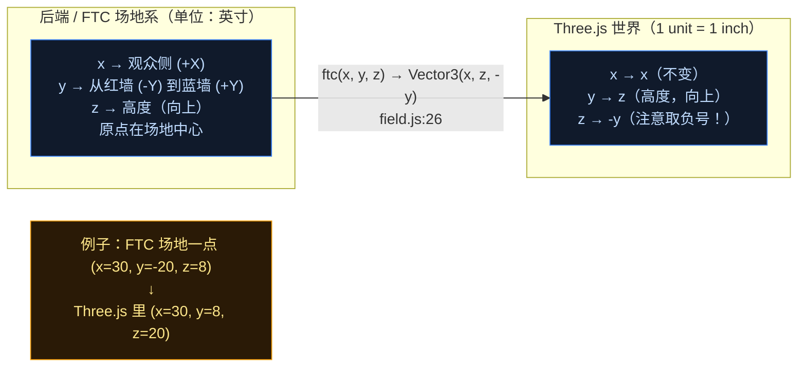
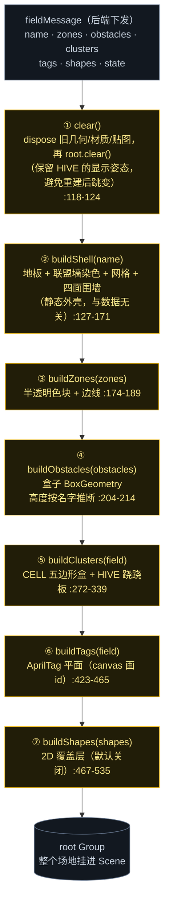
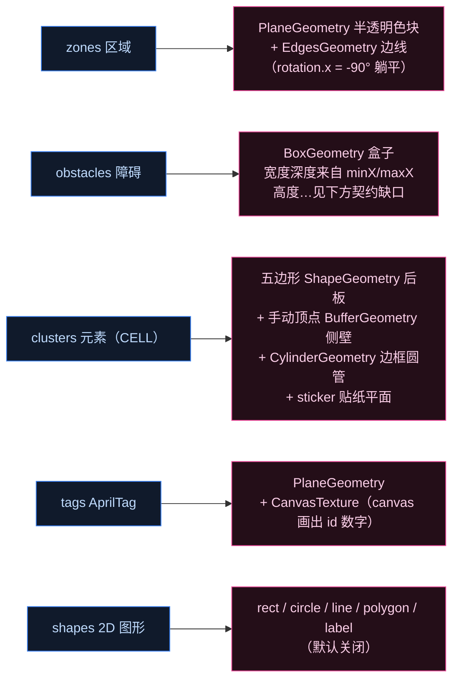
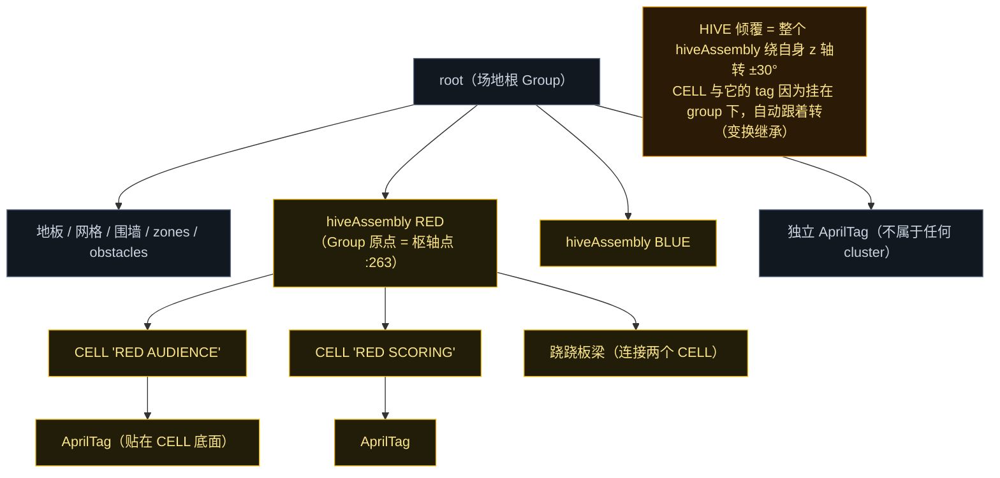
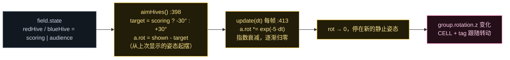

# 场地描述如何变成 3D 几何（Phase 2 · 第 2 步：`field.js`）

一句话：**后端把场地"描述"成一堆通用基元（区域/障碍/标签/元素位姿），前端 `field.js` 按 `rebuild()` 的七步流水线把它们逐个翻译成 Three.js 对象**。前端没有任何硬编码的场地形状——**除了** CELL/HIVE 那一块（第 10 篇分析过的赛季固化部分）。

---

## 图 1：坐标系映射——整个前端只有这一个函数

这是最该先看懂的一张。`field.js:26`：

```js
export function ftc(x, y, z = 0) { return new THREE.Vector3(x, z, -y); }
```



**记法**：后端给的 (x, y) 是**平面坐标**，z 是**高度**；到 Three.js 里，把 **z 提到中间那个分量（y）当高度**，把 **y 取负放到第三个分量（z）**。看到任何 `ftc(...)` 调用都这么换算。

另外 `facingNormal(yawDeg, pitchDeg)`（:29-32）负责把"标签朝向"也一起换算过去。

---

## 图 2：`rebuild()` 七步流水线

前端收到 `hello` / `field` 消息后调 `field.rebuild(m.field)`（`main.js:118 / :128`），内部严格按这个顺序重建：



**两个值得注意的细节**：

- **`clear()` 必须 dispose**（:34-44）：每次 rebuild 都新建大量几何/材质/贴图，不主动 `dispose()` 就会内存泄漏。这是 3D 前端和 DOM 很不同的地方——DOM 节点移除就回收，WebGL 资源要手动释放。
- **`SHOW_FLAT_SHAPES = false`**（:23）：`shapes` 是后端的 2D 俯视绘图层（BIOBUZZ 里是 HIVE 框线、CELL 脚印、FLOWER 圆圈）。但 3D 里这些**都已经有真实立体几何了**，再画一遍只是在地上刷方块，所以默认关掉。

---

## 图 3：每种基元 → 对应什么 Three.js 几何



几个有意思的做法：

- **AprilTag 是"画"出来的**：`tagTexture(id)`（:47-73）用 canvas 2D 画出白底黑框 + 大字 id，再做成 `CanvasTexture` 贴到平面上。还做了自适应字号（不断减小 font-size 直到字能塞进贴纸）。
- **CELL 侧壁是手写顶点**（:293-302）：直接塞 `Float32BufferAttribute` 六个顶点组成两个三角形——这就是第 08 篇说的"typed array 交给 GPU"。
- **CELL 边框用圆管**：`addEdgeTube()`（:243-251）拿 `CylinderGeometry` 沿五边形每条边摆一根，靠 `quaternion.setFromUnitVectors` 把默认朝上的圆柱转到边的方向。

---

## 图 4：场景树与「倾覆联动」——父子关系是关键

为什么 HIVE 倾覆时 CELL 和它上面的 AprilTag 会跟着一起转？答案是**它们被挂在了同一个 Group 下面**，变换自动继承（第 08 篇图 2 讲的 Scene Graph 在这里派上用场）。



---

## 图 5：HIVE 倾覆是怎么动起来的

倾覆不是瞬移，是一个缓动动画，由 `aimHives()` + `update(dt)` 配合完成：



注意：**后端只告诉前端"现在应该是 scoring 还是 audience"**（一个字符串状态，通过 `fieldMessage` 的 `state` 字段下发），**动画完全是前端自己算的**——又一次印证第 09 篇的"后端给目标、前端做平滑"。

---

## 两个真实的前后端「契约缺口」（值得记下来）

数据驱动很好，但边界处有脆弱点，这两处是代码注释里明说的：

| 缺口 | 现状 | 风险 |
|---|---|---|
| **obstacle 没有高度** | 后端 `fieldMessage`（`Simulator.java:407-409`）只发 `name/minX/minY/maxX/maxY/color`，**没有 height**；而 `Field.Obstacle` 类里其实**有** height 字段（`Field.java:21`）。前端只能按**名字正则猜**：`HIVE foot bar`→1.5、`FLOWER`→21.5、`goal`→40，未知默认 1.5（`field.js:193-202`） | 新赛季若出现名字不匹配的新障碍，高度就画错（默认 1.5 会变成贴地的薄片） |
| **tag 尺寸字段名** | 后端发的是 `size`（`Simulator.java:405`），前端曾读 `sizeIn`，导致回退到默认 6.5 in——而 CELL 上的 tag 只有 3.25 in 且间距 3.75 in，结果白色标签互相重叠（注释见 `field.js:427-429`） | 已兼容 `t.size \|\| t.sizeIn`，但属于"靠容错兜住"而非契约明确 |

> 顺带印证第 10 篇：`field.js:232-240` **前端硬编码了一整组赛季常量**（`CELL_PENT`、`CELL_DEPTH`、`HIVE_PIVOT_Z`、`HIVE_Y`、`HIVE_TILT`），和后端 `Field.java:246/252` 的数值重复。明年换赛季，这两处都要改——这也是我建议"几何只留一份、由后端下发"的原因。

## 源码证据

- 坐标系：`field.js:26`（`ftc`）、`:29-32`（`facingNormal`）
- 资源释放：`:34-44`（`disposeObject`）
- 贴图生成：`:47-73`（AprilTag 数字）、`:78-95`（CELL 贴纸）、`:98-109`（文字标签）
- 流水线：`:551-561`（`rebuild`）、`:118-124`（`clear`）、`:127-171`（`buildShell`）、`:174-189`（`buildZones`）、`:204-214`（`buildObstacles`）、`:272-339`（`buildClusters`）、`:423-465`（`buildTags`）、`:467-535`（`buildShapes`）
- CELL / HIVE：`:220-225`（`cellBasis`）、`:232-240`（赛季常量）、`:243-251`（`addEdgeTube`）、`:341-390`（`buildHives`）、`:398-410`（`aimHives`）、`:413-421`（`update` 缓动）
- 后端对照：`Simulator.java:382-411`（`fieldMessage`）、`Field.java:18-47`（`Obstacle`/`Goal`）、`:246/252`（CELL 常量）
