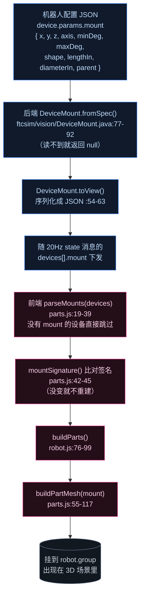
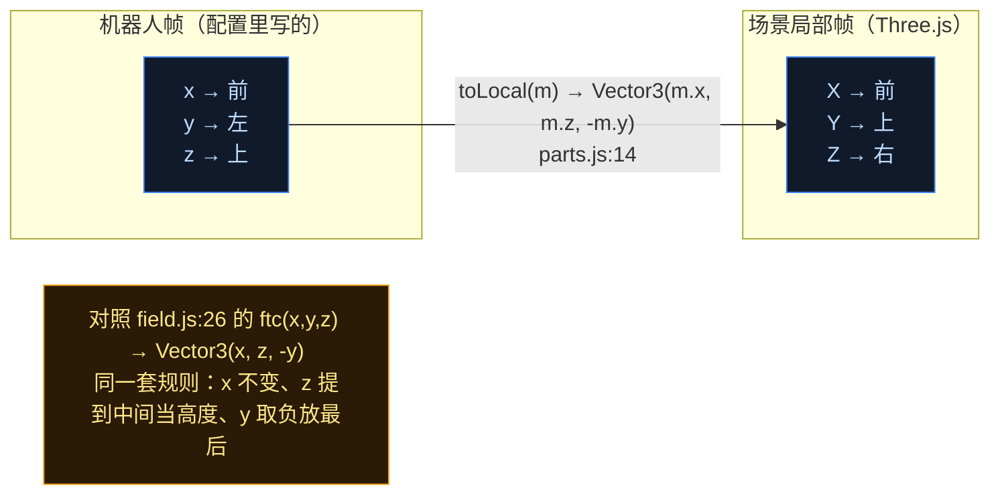
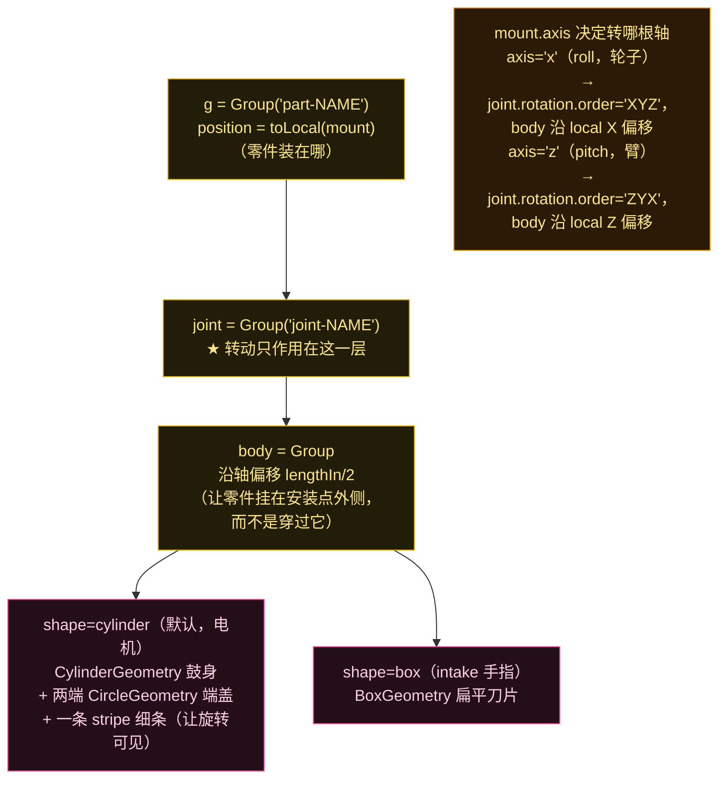
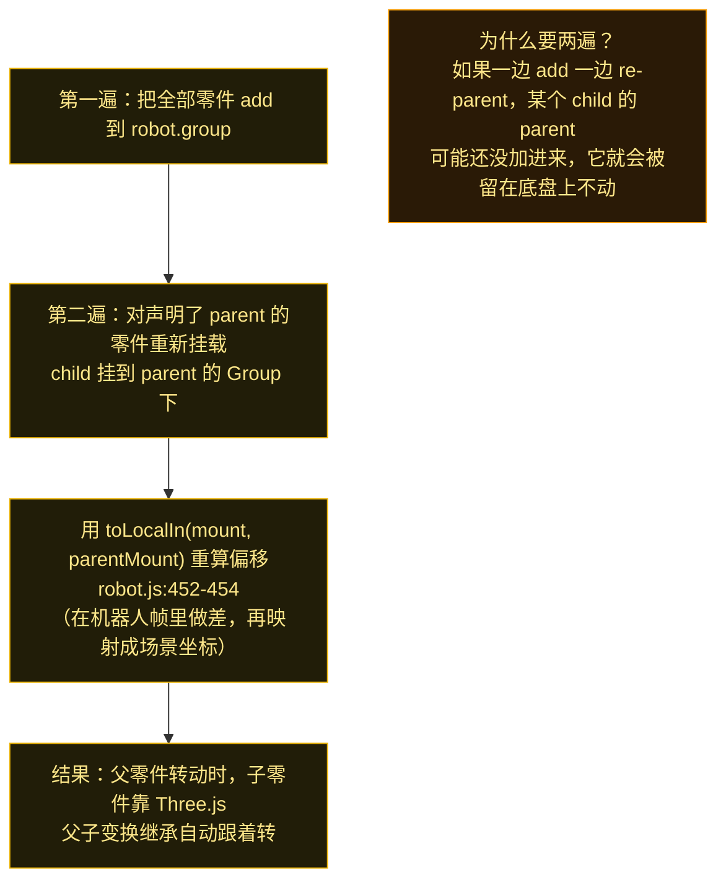
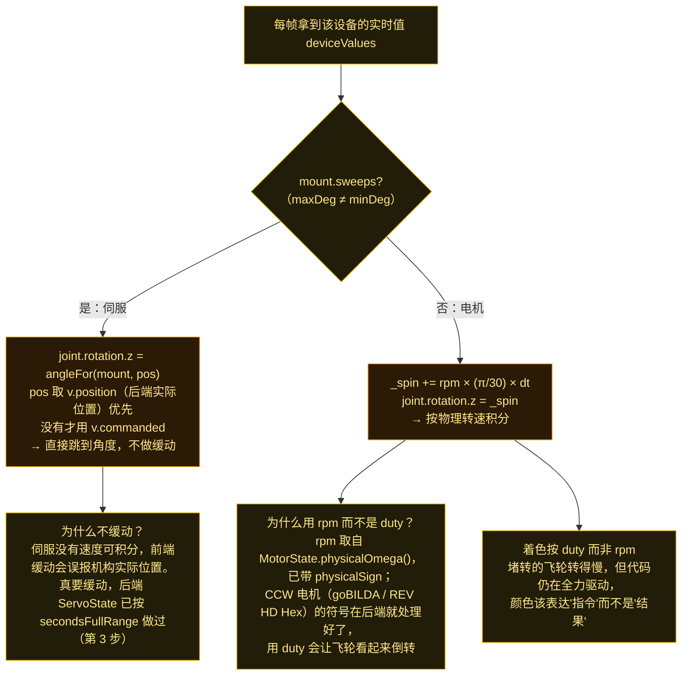

# 零件如何按 mount 摆上机器人（Phase 2 · 第 3 步：`robot.js` / `parts.js`）

一句话：**团队在机器人配置里给电机/伺服声明一个 `mount`（装在哪个位置、绕哪根轴转、行程多少、挂在谁下面），后端把它原样下发，前端据此生成零件并驱动它运动。没有声明 mount 的设备，前端干脆不画。**

---

## 图 1：端到端数据流——从配置里的一行 mount 到屏幕上的一个零件

**一个很重要的设计决策**（`parts.js:4-6` 注释原话）：一个没声明 mount 的设备**不会被停在原点，而是根本不画**——*"absence is a statement, and drawing a part somewhere the team never declared would be a guess"*。这与后端 `DeviceMount.fromSpec` 返回 `null` 的语义是配套的（:47-52）。

---

## 图 2：坐标系——`parts.js` 和 `field.js` 用的是同一套映射

机器人配置写在**机器人帧**（x 前、y 左、z 上，英寸）；场景的局部帧是 **X 前、Y 上、Z 右**。转换就一个函数（`parts.js:14-16`）：

**这套映射在前后端是统一的**：场地用全场坐标、零件用机器人局部坐标，但"x 不变 / z 变高度 / y 取负"这个规则两处一致。所以你在脑子里只需要记**一个**换算。

---

## 图 3：一个零件的三层 Group 结构（为什么要三层）

每个零件不是单个 Mesh，而是 `Group(part) → Group(joint) → Group(body) → Mesh`：

**为什么要把"转动"单独抽一层 joint**：因为 body 需要沿轴偏移半个长度（这样零件是"挂"在安装点外面摆动，像真的机械臂），如果把偏移和旋转混在一层，旋转会把零件甩到别处。把 joint 独立出来后，`updateParts` 只需要设 `joint.rotation.z` 一个值。

---

## 图 4：父子嵌套——子零件跟着父零件动

`mount.parent` 让零件可以嵌套（比如 intake 手指挂在摆臂上）。前端用**两遍**处理（`robot.js:83-98`）：

这和第 11 篇讲的 HIVE 倾覆是**同一个技巧**：把要一起动的东西挂在同一个 Group 下，靠变换继承联动，而不是每帧手动更新每个子物体的世界坐标。

---

## 图 5：伺服和电机的动画策略不同（这里有个很容易踩的坑）

**这条和第 2、3 步的物理是直接咬合的**：后端 `MotorState.physicalSign`（第 2 步）和 `ServoState.secondsFullRange` 缓动（第 3 步）在这里决定了前端该读哪个数、怎么动。

---

## 顺带：机器人自身的位姿是怎么平滑的

`robot.update(dt)`（`robot.js:304-331`）做了两件事，正好呼应第 09 篇的双时钟：

1. **用速度外推**（:306-310）：后端 20 Hz 的位姿是 50 ms 前的，前端按 `vx/vy/ω` 外推最多 0.12 s 来补偿这段延迟；
2. **指数平滑**（:312-315）：`k = 1 - exp(-14·dt)`，把当前显示位姿朝目标插值。

另外底盘刻意做成**半透明**（`CHASSIS_OPACITY = 0.22`，且 `depthWrite: false`），这样装在内部的机构（飞轮、intake 伺服）能从外面看见；同时用**不透明的边线**勾勒轮廓（:140-145）——注释里还记了一笔踩坑：橙色边太扎眼、蓝色边和里程轨迹颜色太接近导致看不清。

## 源码证据

- 后端 mount 模型：`ftcsim/vision/DeviceMount.java:22-33`（字段）、`:44`（`sweeps`）、`:54-63`（`toView` 下发）、`:77-92`（`fromSpec` 从配置读）
- 前端解析与构建：`parts.js:14-16`（`toLocal`）、`:19-39`（`parseMounts`）、`:42-45`（`mountSignature`）、`:55-117`（`buildPartMesh`）、`:120-124`（`angleFor`）
- 机器人装配：`robot.js:56-63`（`setDevices`）、`:66-69`（`setDeviceValues`）、`:76-99`（`buildParts` 两遍挂载）、`:101-187`（`buildBody` 底盘与轮子）、`:193-235`（相机 pod）、`:246-258`（`setCamMount` 接管团队相机位姿）、`:260-286`（`setSpec`）、`:289-301`（`setState`）、`:304-331`（`update` 外推+平滑）、`:341-368`（`updateParts`）、`:391-415`（`setAmmo` 弹药球）、`:452-454`（`toLocalIn`）
- 对照：`main.js:490-491`（注释：没有 mount 的零件不画）、`field.js:26`（同一套轴映射）
