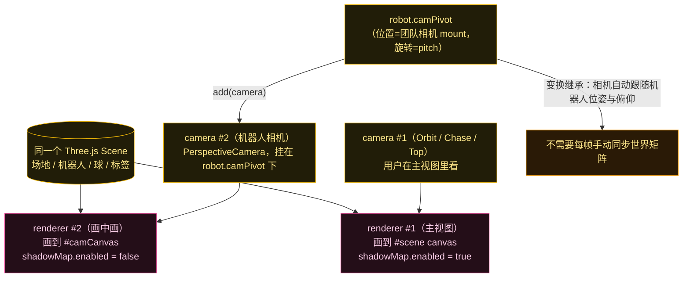
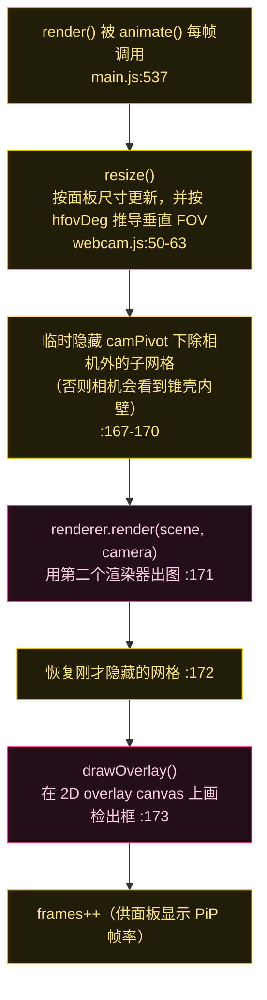
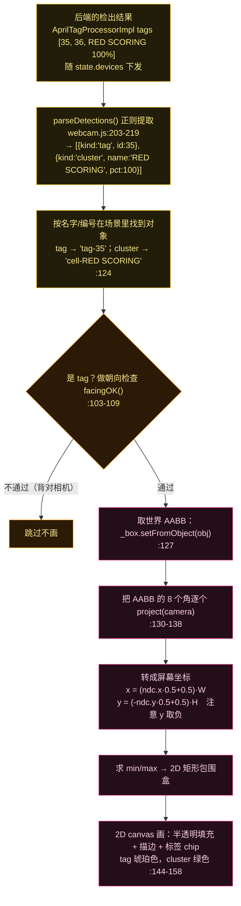
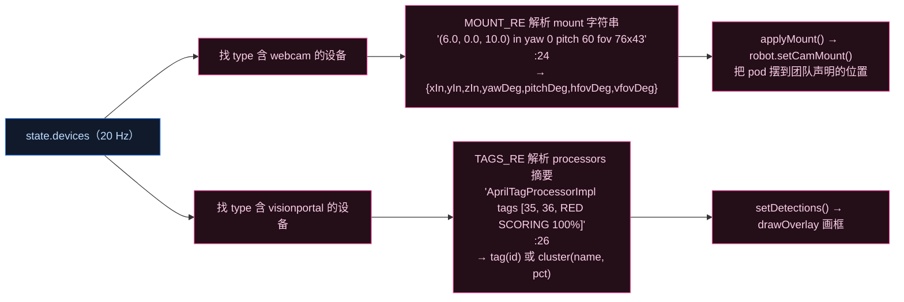
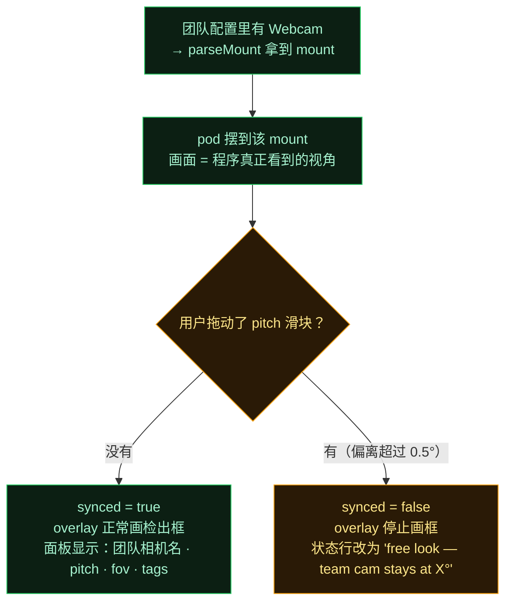

# 机器人摄像头与 AprilTag 检出框（Phase 2 · 第 4 步：`webcam.js`）

一句话：**画中画 = 第二个 WebGLRenderer + 第二个 PerspectiveCamera，渲染的是同一个 Scene；相机挂在机器人的 `camPivot` 下，靠变换继承自动拿到位姿与俯仰角。而画面上的检出框不是后端给的像素坐标，是前端自己把标签的 3D 包围盒投影到相机算出来的。**

这一篇正好接回 **Phase 1 第 6 步 Vision**：后端只有"几何检出"没有图像帧，前端也就用"几何投影"来画框——两边都不碰像素，是自洽的一套。

---

## 图 1：画中画的架构——两个渲染器，一个场景

**两个容易忽略的工程细节**（都在代码注释里）：

- **画中画的渲染器关掉了阴影**（`webcam.js:33`）。因为两个 renderer 共享同一个 `DirectionalLight`，若都写它的 shadow map，每帧要重建两次——既闪烁又浪费。所以主视图保留完整阴影，PiP 关掉。
- **相机做了 90° 修正**（:46）：Three.js 相机看向自己的 **-Z**，而 pod 的"前方"是机器人的 **+X**，所以 `camera.rotation.y = -π/2`。不这么做的话，pitch 转轴会让画面"翻滚"而不是"俯仰"。

---

## 图 2：`render()` 每帧做了什么

**FOV 的处理很有讲究**：团队配置的是**水平** FOV（`hfovDeg`），而 Three.js 的 `camera.fov` 是**垂直** FOV。所以每次 resize 和每次换 mount 都要用 aspect 推导一次（:61），保证画中画的视野与后端检出的投影口径一致。

---

## 图 3：检出框是怎么画出来的（本步核心）

后端只告诉前端"检出了哪些标签"，**框的位置是前端算的**：

**最妙的一点**：前端复刻了后端的一部分可见性判定。`facingOK()`（:103-109）用的阈值 `MIN_FACING = 0.25`（:28）**与后端 `AprilTagProcessorImpl.Camera.see()` 里标签用的 0.25 是同一个数**。注释（:100-102）说得很清楚：后端只报告它真能看到的标签，所以前端也要做同样的测试——否则 HIVE 背面的标签可能"刚好投影进画面"就被框出来，而实际程序根本没检出它。

> 这带来一个维护性提醒：这个 0.25 现在**前后端各写了一份**。将来调后端判定阈值时，记得同步这里。

---

## 图 4：数据从哪来——两条正则

`parseMount` 与 `parseDetections` 都是从 20 Hz `state.devices` 消息里"抠"出来的：

**这里有个不一致值得记下来**：第 12 篇讲过，电机/伺服的 `DeviceMount` 下发的是**结构化 JSON 对象**（`DeviceMount.toView()`），前端直接读字段。而**相机 mount 是一个格式化字符串**，前端只能靠正则拆（:22-24 注释也点明了这点）。字符串解析更脆弱——后端格式一变（比如加个字段或改个分隔符），正则就失效。将来若要顺手改进，把相机 mount 也改成结构化对象是低风险且划算的。

---

## 图 5：`synced` —— 一个很诚实的设计

**为什么这样设计**：一旦你手动改了俯仰角，画中画就不再是"团队程序看到的画面"了，此时再画上检出框就是在**撒谎**——那些框是后端按团队 mount 算出来的。所以宁可停画并明确说明"现在是自由视角"。这类"宁可不画也不画错"的取舍，在整个项目里反复出现（比如第 12 篇"没有 mount 就不画零件"）。

## 源码证据

- PiP 架构：`webcam.js:31-34`（第二 renderer、关阴影）、`:42-47`（第二 camera、`rotation.y=-π/2`、挂到 `camPivot`）、`:163-175`（`render` 隐藏 pod→渲染→恢复→画框）
- FOV 推导：`:50-63`（`resize`，水平 FOV 为锚点推导垂直）
- 检出框：`:103-109`（`facingOK` 与 `MIN_FACING=0.25`）、`:112-160`（AABB→8 角投影→屏幕坐标→2D 绘制）
- 数据解析：`:189-200`（`parseMount`，正则拆字符串）、`:203-219`（`parseDetections`）
- 联动：`main.js:415`（创建）、`:438-445`（`applyMount`）、`:502`（`setDetections`）、`:536-544`（每帧 render 与 fps）、`:456-473`（状态行与 synced 文案）
- 后端对照：`AprilTagProcessorImpl.java:198`（`cam.see(..., 0.25)` 同样的朝向阈值）
