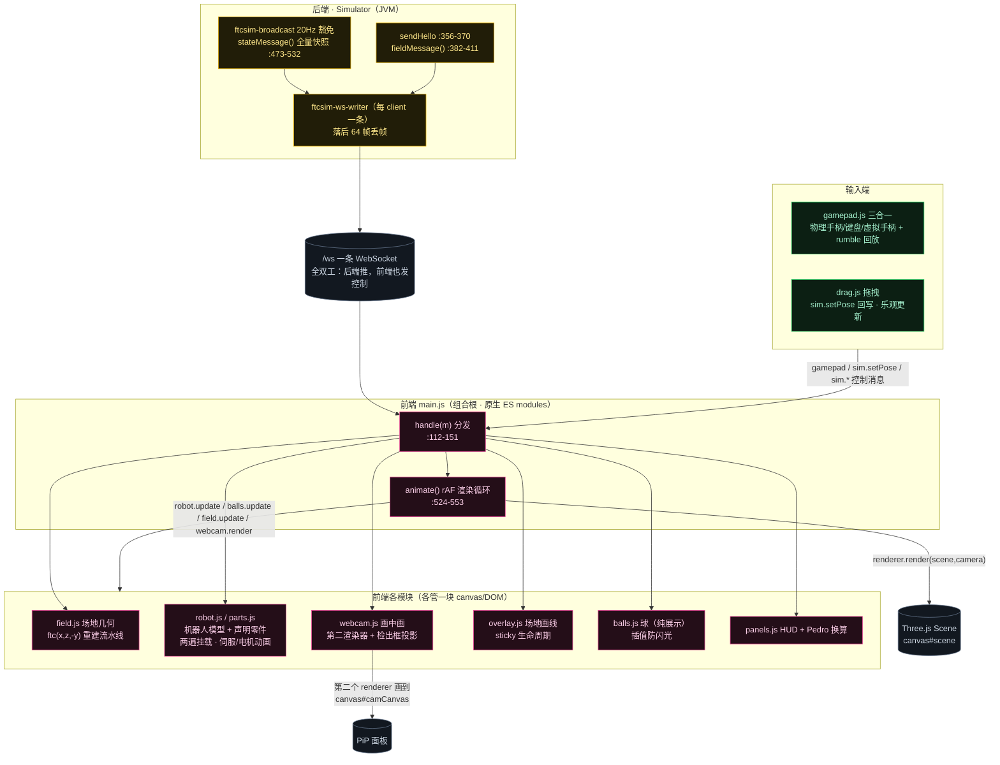
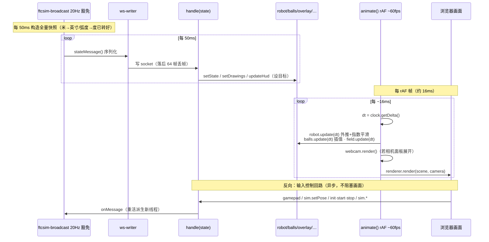

# FTCSim Phase 2 总览（第 7 步：结构图 + 逐帧时序图）

Phase 2「3D 前端怎么把后端世界画出来」到此收官。本文两张图：**图 1 = 前端模块 + 后端消息契约拓扑结构图**，**图 2 = 一次 `state` 消息的旅程 + 一个渲染帧的时序图**。

配色：**黄 = 后端/模拟器消息契约** · **粉 = 前端 ES module** · **灰 = 核心（Scene / WebSocket / canvas）** · **绿 = 输入端（手柄/键盘/拖拽）**。

> 配套结论见研究笔记 `notes/research/sim-physics-research-notes.md`（Phase 2 结论 28–47）；本图的详细版分见 `docs/frontend-3d/01-threejs-basics.md`、`02-field-3d-build.md`、`03-robot-parts.md`、`04-webcam-pip.md`
与 `docs/architecture/02-websocket-drive.md`、`03-coordinate-systems.md`。

## 图 1：前端模块拓扑 + 后端消息契约（结构图）

**一句话**：`main.js` 是唯一入口 + 消息分发中枢；各模块只对"自己那块世界"负责；后端只推三种消息（hello/field/state），前端没有状态机、收到即覆盖。

## 图 2：一次 `state` 消息的旅程 + 一个渲染帧的时序（时序图）

**两条时钟**：后端 20 Hz 决定"目标在哪"，前端 60 fps 决定"怎么平滑走过去"——后端慢不影响画面流畅（结论 30、46）。

## 频率/节奏速查表

| 动作 | 频率 | 节拍来源 | 备注 |
|---|---|---|---|
| 后端推 `state` | **20 Hz**（50 ms） | `ftcsim-broadcast`（`Simulator.java:625`） | 全量快照，收到即覆盖 |
| 前端渲染 | **~60 fps**（rAF） | `animate()`（`main.js:524`） | 各 `update(dt)` 插值后 `renderer.render` |
| 拖拽回写 | **~30 Hz**（35 ms） | `drag.js SEND_MS=35`（`:9,31-40`） | `sim.setPose`，乐观更新 |
| 手柄轮询 | **~30 Hz**（33 ms） | `gamepad.js loop()`（`:205-251`） | `sendIfNeeded` 只在变化时发 |

## Phase 2 成果索引

| 图 | 文件 | 对应小步 |
|---|---|---|
| Three.js 基础（Scene/Camera/Renderer/坐标系/双层/帧循环） | `docs/frontend-3d/01-threejs-basics.md` | 准备篇 |
| WebSocket 消息驱动（hello/field/state + 双时钟） | `docs/architecture/02-websocket-drive.md` | 第 1 步 |
| 场地 → 3D（rebuild 流水线 + 契约缺口） | `docs/frontend-3d/02-field-3d-build.md` | 第 2 步 |
| mount → 零件（三层 Group + 两遍挂载 + 伺服/电机动画） | `docs/frontend-3d/03-robot-parts.md` | 第 3 步 |
| 画中画 + 检出框投影 + synced | `docs/frontend-3d/04-webcam-pip.md` | 第 4 步 |
| 三套坐标系总图（含数值演算） | `docs/architecture/03-coordinate-systems.md` | 第 5 步 |
| 赛季可复用分层（泄漏点与剥离） | `docs/seasons/01-season-abstraction.md` | 第 7 步配套 |
| **总览：结构 + 逐帧时序** | **`docs/frontend-3d/05-phase2-overview.md`** | **第 7 步** |

完整结论见研究笔记 `notes/research/sim-physics-research-notes.md`（Phase 1 结论 1–27；Phase 2 结论 28–47）。

## 源码证据

- 后端消息契约：`Simulator.java:356-370`（sendHello）、`:382-411`（fieldMessage）、`:473-532`（stateMessage）、`:611-652`（broadcastLoop 20Hz）、`:625`（广播 state）
- 前端入口与循环：`main.js:112-151`（handle 分发）、`:524-553`（animate）、`:63-96`（world pieces/trail）
- 各模块：`field.js:26`（ftc）、`robot.js:304-331`（update 平滑）、`parts.js:55-117`（buildPartMesh）、`webcam.js:30-47`（第二渲染器）、`overlay.js:257-265`（sticky）、`balls.js:46-83`（setState/update）、`panels.js:20-22`（Pedro）、`gamepad.js:205-251`（loop）、`drag.js:9,31-40`（sim.setPose）
