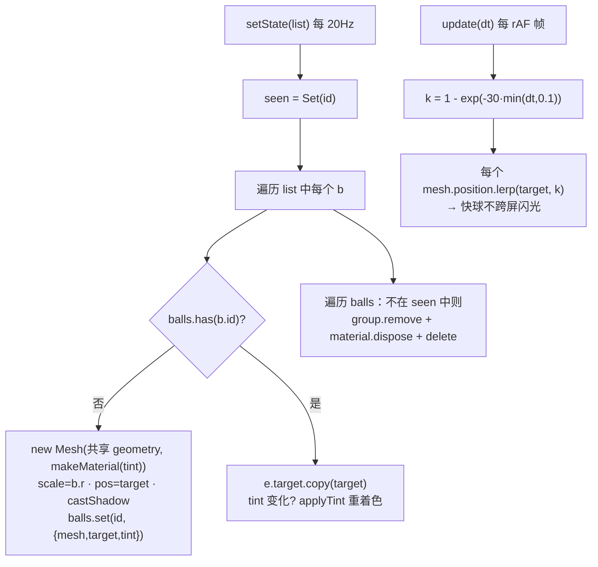
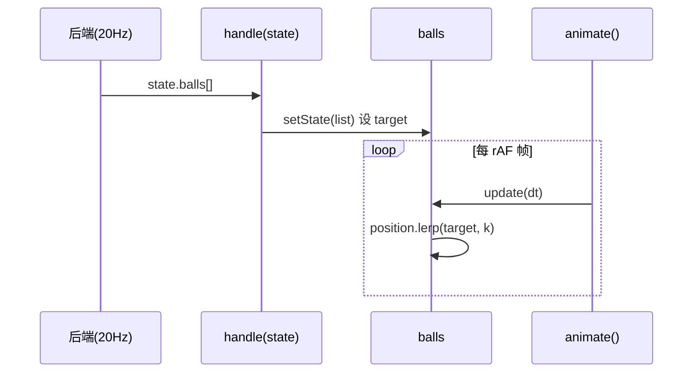
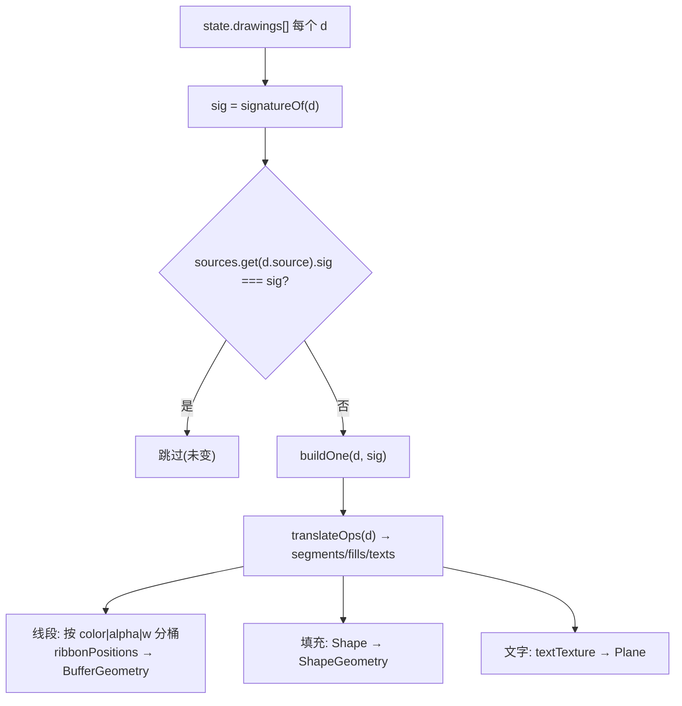
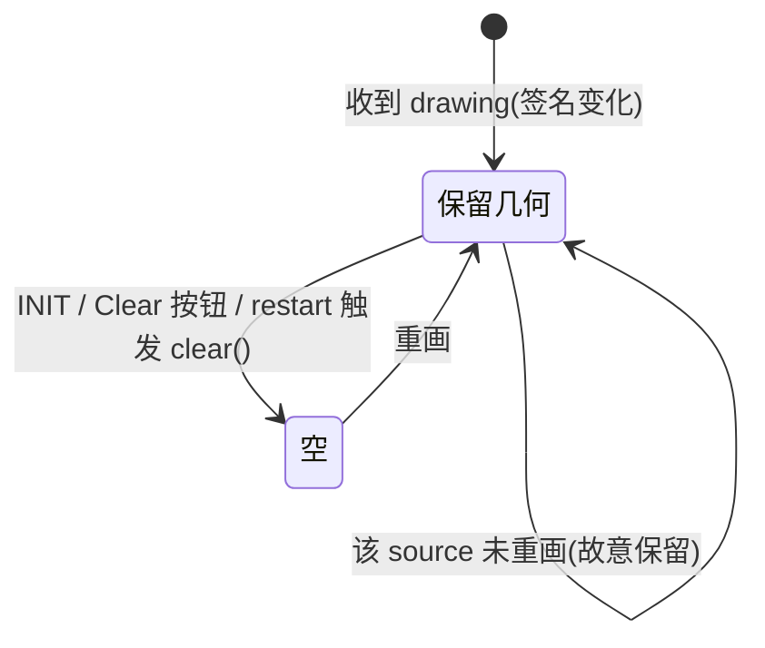
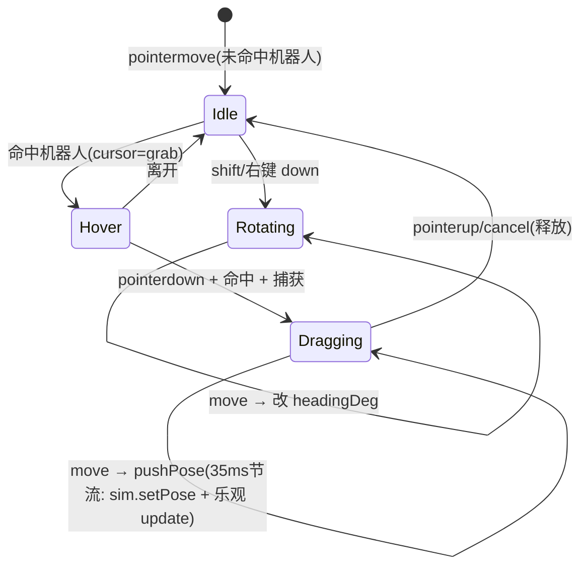
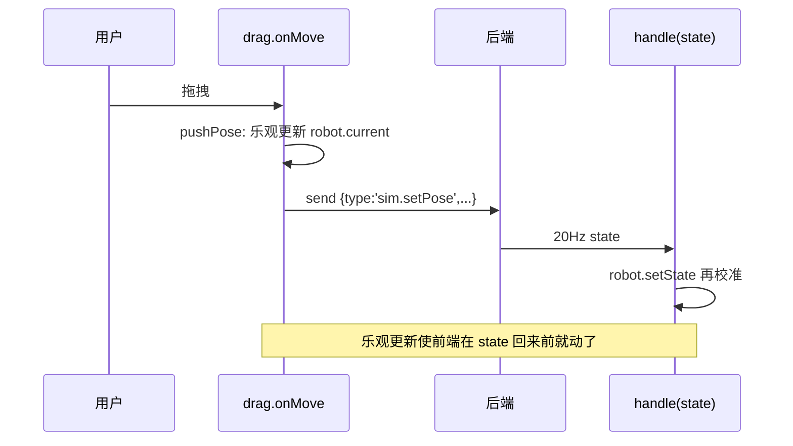
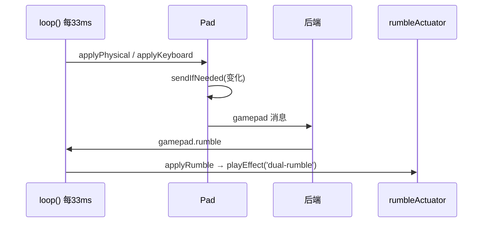

# 输入与叠加层模块（balls / overlay / drag / gamepad）

> 2026-10-24 基于源码探索（medium）。本篇是 `docs/frontend-3d/05-phase2-overview.md` 总览的**逐模块展开**，把结论 41–44 补记的内容落成图。四个模块都挂在 `main.js` 的 `scene` 上，由 `handle(m)` 消息分发驱动"目标"，由 `animate()` 每帧 `update` 平滑渲染（`main.js:524-553`）。

**公共渲染节奏**（绘图标注用）：后端 20 Hz 推 `state` 设目标 → 前端 60 fps `animate()` 平滑；拖拽回写 ~30 Hz/35 ms（`drag.js:9`）；手柄轮询 ~30 Hz/33 ms（`gamepad.js:250`）。

**坐标映射一致性**（三者都是同一套 `x 不变 / z 变高度 / y 取负`）：balls 内联 `Vector3(b.x, b.z, -b.y)`（`balls.js:50`）、overlay 用 `ftc()`（`field.js:26`）与内联 `(x,0,-y)`（`overlay.js:111-116`）、drag 用 `toFtc = {x:p.x, y:-p.z}`（`drag.js:29`）。

---

## 1. `balls.js` —— 只画球，物理在后端，插值避免"闪光"

### 1.1 结构与数据

- 导出 `createBalls(scene)`（`:29-94`）→ 返回 `{ setState, update, clear, count }`。
- 共享几何体：`SphereGeometry(1,20,14)` 单位球（`:35`），每个 mesh 用 `scale` 缩放成各自半径——**共享几何体是性能关键**。
- 球池 `Map<id, { mesh, target, tint }>`（`:37`）：`target` 是来自最新 state 的目标位置，`update` 指数插值逼近。
- 着色：`tintOf(b)`（`:17-21`）按 `b.cell`/`b.goal` 选类别，`applyTint(mat, tint)`（`:23-27`）三套颜色。

### 1.2 消息关系

- 消费 `state.balls`：`handle()` 在 `case 'state'` 调 `balls.setState(m.balls)`（`main.js:134`）。
- **不回写任何消息**，物理全在后端 `Projectile`。
- `hello` 触发 `balls.clear()`（`main.js:123`）；`field` 重建不清球。
- 每帧 `animate()` 调 `balls.update(dt)`（`main.js:529`）。





---

## 2. `overlay.js` —— 把后端画线操作渲染成 3D 地面几何（sticky）

### 2.1 结构与数据

- 导出 `createOverlay(scene)`（`:158-279`）→ `{ setDrawings, setVisible, clear, group, stats }`。
- `sources: Map<source, { group, sig }>`（`:163`）：每个来源（Road Runner / Pedro / Panels…）一个子 Group + 上次"签名"。
- `translateOps(d)`（`:43-97`）把 drawing 转成 `{ segments, fills, texts }`（FTC inches）；`signatureOf(d)`（`:138-156`）廉价采样签名，判断"自上一帧未变则跳过重建"。
- 几何构建：线段→ribbon（扁平带，`:100-119`）、填充→`Shape`+`ShapeGeometry`（`:212-228`）、文字→canvas 贴图 `textTexture`（`:121-135`）。

### 2.2 消息关系与 sticky 生命周期

- 消费 `state.drawings`：`handle()` 在 `case 'state'` 调 `overlay.setDrawings(m.drawings)`（`main.js:136`）。
- **不回写消息**，纯展示。
- **sticky**：后端只在绘画"新鲜"时广播（最后包后 3s 丢弃），这里各 source 保留最后几何，直到：① 该源被重画（签名变化）；② 团队代码清空；③ 本页 INIT / Clear 按钮 / restart 触发 `clear()`。





---

## 3. `drag.js` —— 用 `sim.setPose` 同一条消息回写，摇杆补偿

### 3.1 结构与数据

- 入口 `startRobotDrag({ canvas, camera, robot, send })`（`:11-104`），副作用型（无返回值）。
- 拖拽状态 `drag`（`:16`）：`{ rotate, x, y, h, ox, oy }`，全为 FTC 帧单位（英寸 / 度）。
- 工具：`raycaster`、`ground = Plane((0,1,0),0)`（`:12-15`）；常量 `LIMIT=72`（半场）、`SEND_MS=35`（`:8-9`）。

### 3.2 消息关系

- **回写** `sim.setPose`：`pushPose()`（`:31-40`）节流 35 ms，发 `{ type:'sim.setPose', x, y, headingDeg }`，并**乐观更新** `robot.current`（立即跟随光标，不等 20 Hz state）。
- **不消费**任何后端消息（纯输入→回写）。
- 与 `OrbitControls`：用 `capture:true` + `stopPropagation` 抢手势（`:46-47, 86-90`），只在悬停机器人时拦截，否则保留轨道相机。





---

## 4. `gamepad.js` —— 物理手柄 + 键盘 + 虚拟手柄三合一，及 rumble 回放

### 4.1 结构

- `export class Pad`（`:17-60`）：单个手柄状态机——`constructor(id, send)`、`applyPhysical(gp)`（`:30-42`）、`applyKeyboard()`（`:44-51`）、`sendIfNeeded(force)`（`:53-59`，仅变化时发 `{type:'gamepad', id, state}`）。
- `export function startGamepads({ send, toast, host1, host2 })`（`:64-266`）→ `{ pads, applyRumble, stopAllRumble }`：
  - `buildPad(id)`（`:75-132`）虚拟手柄 DOM；`renderPad(id)`（`:134-148`）渲染到 DOM；
  - `loop()`（`:205-251`）30 Hz 轮询：DS 式分配（Start+A→GP1 / Start+B→GP2，`:217-230`）、按优先级 `applyPhysical` / `applyKeyboard` / idle（`:231-245`）、`sendIfNeeded`、`renderPad`；
  - `applyRumble(m)`（`:181-198`）消费 `gamepad.rumble` 消息；`stopAllRumble()`（`:199-201`）消费 `gamepad.rumble.stop`。

### 4.2 输入融合（修正后的优先级，见 `notes/research` 结论 44）

每轮先查物理手柄 → 否则若 GP1 有键盘按键则 `applyKeyboard()` → **两者都无时 `p.s` 保持原值**，而该"原值"正是虚拟手柄直接写入的。故虚拟手柄**不是轮询源**，仅在物理/键盘都未激活时才保留。

### 4.3 消息关系

- 发送 `gamepad`：`sendIfNeeded` → `{type:'gamepad', id, state}`（`:57`），仅变化时发，约 30 Hz。
- 消费 `gamepad.rumble` / `gamepad.rumble.stop`：`applyRumble` / `stopAllRumble`，经 `main.js:145-146` 路由。

```mermaid
classDiagram
  class Pad {
    +id
    +send()
    +keys: Set
    +s: {lx,ly,rx,ry,lt,rt,type,buttons...}
    +lastSent
    +physicalIndex
    +applyPhysical(gp)
    +applyKeyboard()
    +sendIfNeeded(force)
  }
  class startGamepads {
    +pads: {1:Pad,2:Pad}
    +hosts
    +rumble: {1,2 timers}
    +views
    +loop() 30Hz
    +applyRumble(m)
    +stopAllRumble()
  }
  startGamepads --> Pad : 创建/持有
  Pad ..> "send {type:'gamepad',id,state}" : WebSocket
  startGamepads ..> "applyRumble / stopAllRumble" : 消费 gamepad.rumble
```



---

## 跨模块速查

| 模块 | 导出 | 消费消息 | 发送消息 | 上游调用点 |
|---|---|---|---|---|
| balls.js | `createBalls` → `{setState,update,clear,count}` | `state.balls`（`main.js:134`）、`hello` 触发 `clear`（`:123`） | 无 | `main.js:68` 创建、`:529` update |
| overlay.js | `createOverlay` → `{setDrawings,setVisible,clear,group,stats}` | `state.drawings`（`:136`）、生命周期经 INIT/Clear/restart（`main.js:266,269,198`） | 无 | `main.js:66` 创建、`:381` setVisible |
| drag.js | `startRobotDrag({canvas,camera,robot,send})` | 无（纯输入） | `sim.setPose`（`:35,101`） | `main.js:557` |
| gamepad.js | `class Pad`、`startGamepads` → `{pads,applyRumble,stopAllRumble}` | `gamepad.rumble`（`:145`）、`gamepad.rumble.stop`（`:146`） | `gamepad`（`:57`） | `main.js:555` 创建 |
