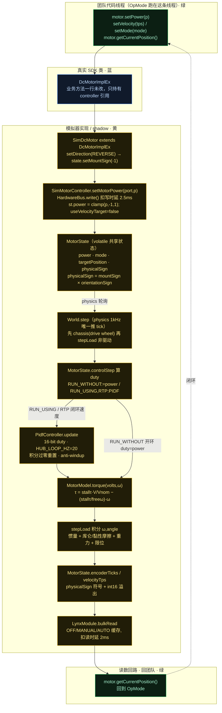

# FTCSim 电机信号链图（Phase 1 · 第 2 步：电机信号链）

配色按代码归属：**黄 = 模拟器实现**（ftcsim.* 含挂在 SDK 包名下的 shadow）· **蓝 = 真 SDK**（DcMotorImplEx 等真实类）· **绿 = 团队代码**（OpMode 机器人代码）。

核心问题「为什么模拟器里写的 OpMode 不改一行就能驱动真机」的答案：整条链路里，OpMode 碰到的唯一 SDK 类就是真实的 `DcMotorImplEx`（`SimDcMotor` 只是它的子类，没改任何业务方法）。模拟器只替换了两处硬件绑定件——把 `SimMotorController` 当 `DcMotorController` 注入、以及 shadow `LynxModule`。于是写命令 → `MotorState.power` → `World` 物理积分；读命令 → `MotorState.encoderTicks/velocityTps`，同一套 FQN、同一套方法签名。

## 图 1：全链路 setPower → 物理积分 → getCurrentPosition

## 图 2：跨线程时序（setPower 与 getCurrentPosition 如何经 MotorState 解耦）

这张图解释第 1 步结论 3 里那句「tick 与机器人代码是生产者-消费者，通过设备状态解耦」——团队代码线程和 physics 线程**从不直接调用彼此**，只读写同一块 `MotorState`。

```mermaid
sequenceDiagram
  participant T as 团队代码线程 (OpMode)
  participant SDK as DcMotorImplEx
  participant SM as SimMotorController
  participant MS as MotorState (共享)
  participant PH as physics 线程 (World.step)
  participant MM as MotorModel

  rect rgb(12,31,19)
  Note over T,SDK: 写命令：团队代码从不等待物理
  T->>SDK: setPower(0.8)
  SDK->>SM: setMotorPower(2, 0.8)
  SM->>SM: HardwareBus.write() 扣 2.5ms 写时延
  SM->>MS: power = 0.8（volatile）
  T-->>T: 立即返回，继续跑 loop()
  end

  rect rgb(33,29,8)
  Note over PH,MM: 物理积分：1kHz 后台循环，生产者-消费者经 MotorState 解耦
  loop 每 1ms（1kHz）
    PH->>MS: 读 power / target / mode
    PH->>PH: controlStep 算 duty（PIDF 或 =power）
    PH->>MM: torque(volts, ω)
    MM-->>PH: τ
    PH->>MS: 写 angle, ω（stepLoad 积分）
  end
  end

  rect rgb(16,26,43)
  Note over T,SDK: 读命令：经 bulkRead 缓存，扣 2ms 读时延
  T->>SDK: getCurrentPosition()
  SDK->>SM: getMotorCurrentPosition(2)
  SM->>SM: hub.bulkRead() 扣 2ms + 缓存语义
  SM->>MS: encoderTicks() = physicalSign·angle − offset
  MS-->>T: ticks（int，controller-frame）
  end
```

## 一张图记牢的三个"坑"

- **drive wheel 不走 `stepLoad`**：底盘（`Chassis.step`）先把轮轴转速反解出来，用 `observeShaftSpeed` 直接覆写 `omega`，`torqueStep` 只用来算反作用力和电流（轮子被地面约束，不是扭矩积分出来的）。只有**非驱动电机**（臂、intake 等）才用惯量积分（`MotorState.stepLoad`）。`World.step` 里 `if (m.isDriveWheel) continue;` 就是这一句分开的。
- **符号桥 `physicalSign` 是双向的**：写命令时 `power` 是 controller-frame（电机 nominal FORWARD）；读 encoder 时 `angleControllerFrame = physicalSign·angle` 又转回 controller-frame。`setDirection(REVERSE)` 改的是 `mountSign`，`orientationSign` 来自电机 CCW 型号，`physicalSign = mountSign × orientationSign` 由乘积派生——**永远别直接设 `physicalSign`**。
- **速度读数有 int16 溢出**：`velocityTps()` 默认强转 `(short)`（`emulateVelocityOverflow`），与真 hub 一致——高速时读数会"绕回"，这是真机特性不是 bug。

## 为什么"模拟器代码 = 真机代码"（展开）

1. 构造 `SimDcMotor` 时把一个 `SimMotorController` 当 `DcMotorController` 注入（替代真 hub 的 `LynxMotorController`）；
2. `LynxModule` 被 shadow（`ftc-sdk/shadowed-classes.txt` 第 6 行），其余 SDK 类（含 `DcMotorImplEx`、`PidfController` 所在层级）**原样使用**。

于是：
- **写命令**：真机 → 真实硬件协议；模拟器 → `SimMotorController` → `MotorState.power` → `World` 物理积分。
- **读命令**：真机 → 编码器硬件；模拟器 → `MotorState.encoderTicks/velocityTps`（已含 controller-frame 符号与 int16 溢出）。
- 两者用同一套 FQN、同一套 SDK 方法签名，所以 OpMode 里 `setPower/getCurrentPosition/setVelocity/setMode` 逐字不变即可驱动真机。

## 源码证据

- `sim/src/main/java/ftcsim/hardware/SimDcMotor.java:12（extends DcMotorImplEx）, 36-42（setDirection→mountSign）`
- `sim/src/main/java/ftcsim/hardware/SimMotorController.java:69-74（setMotorPower 写 power+扣写时延）, 82（getMotorCurrentPosition→bulkRead）, 47-56（fillBulkData）, 89-95（setMotorVelocity）`
- `sim/src/main/java/com/qualcomm/hardware/lynx/LynxModule.java:120-148（bulkRead 缓存语义+扣读时延）`
- `sim/src/main/java/ftcsim/physics/MotorState.java:45,70,77（physicalSign）, 101-123（读数/符号）, 126-153（controlStep 算 duty）, 159-198（torqueStep/stepLoad 积分）`
- `sim/src/main/java/ftcsim/physics/PidfController.java:23-45（HUB_LOOP_HZ、积分过零、anti-windup）`
- `sim/src/main/java/ftcsim/physics/MotorModel.java:4-31（线性直流电机公式）`
- `sim/src/main/java/ftcsim/physics/World.java:84-101（step 顺序）`
- `sim/src/main/java/ftcsim/physics/Chassis.java:53-103（drive wheel 经 observeShaftSpeed 设 omega）`

配套研究笔记：`notes/research/sim-physics-research-notes.md` 结论 4–9。
