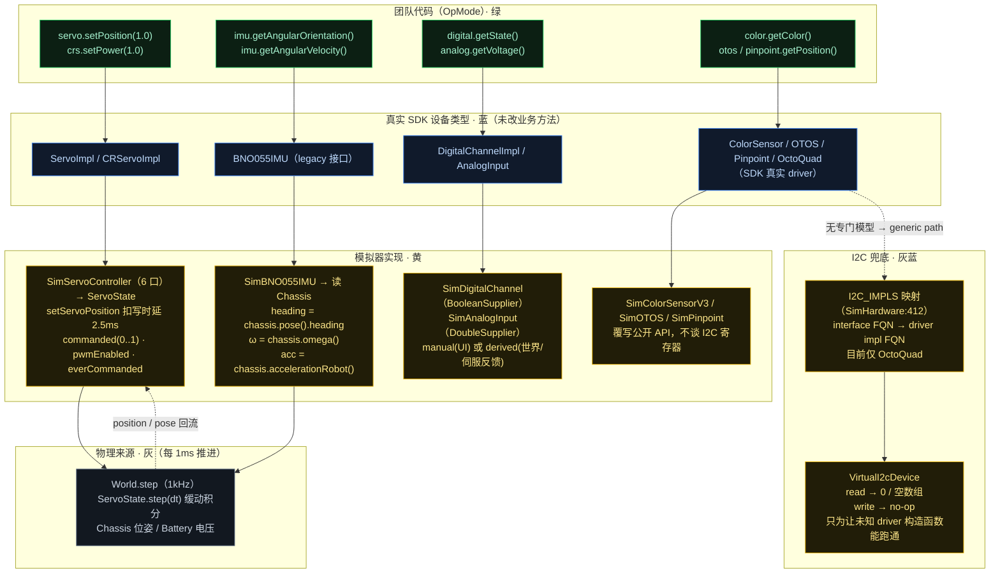
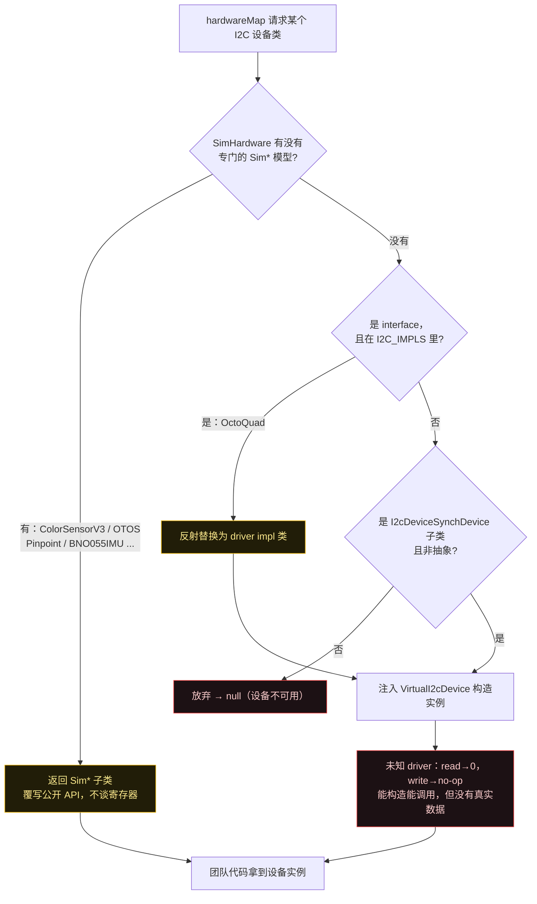

# FTCSim 传感器模型图（Phase 1 · 第 3 步：传感器模型）

配色按代码归属：**黄 = 模拟器实现**（ftcsim.*）· **蓝 = 真 SDK**（OpMode 拿到的仍是真的 SDK 设备类型）· **绿 = 团队代码** · **灰 = 物理/世界来源**。

本步一句话结论：传感器层和第 2 步电机同源——**`Sim*` 类继承/实现 SDK 真实设备类型**，所以 OpMode `hardwareMap.get(...)` 拿到的还是"真的 SDK 类型"；区别只在数据源：**IMU 由底盘真值反算、伺服由 ServoState 按 `secondsFullRange` 缓动、数字/模拟走手动+派生双源、I2C 有模型优先没模型则丢给 VirtualI2cDevice 兜底**。

## 图 1：四类传感器的「写 → 模拟 → 读」总览



## 图 2：伺服缓动（为什么 `getPosition()` 读到的不是"当前位置"）

这是本步最值得记住的一张图：`commanded` 和 `position` 是**两个不同的数**，中间隔着 `secondsFullRange` 的限速爬升。

```mermaid
sequenceDiagram
  participant T as 团队代码 (OpMode)
  participant SC as SimServoController
  participant SS as ServoState
  participant W as World.step (1kHz)

  Note over T,SC: 写命令：controller 侧立即生效
  T->>SC: setPosition(1.0)
  SC->>SC: HardwareBus.write() 扣 2.5ms 写时延
  SC->>SS: commanded=1.0, pwmEnabled=true, everCommanded=true
  T->>SC: getPosition()
  SC-->>T: 返回 commanded=1.0（注意：这是指令值！）

  Note over SS,W: 物理缓动：伺服只在 World.step 里按 secondsFullRange 限速移动
  loop 每 1ms 一步（0.6s ≈ 600 步）
    W->>SS: ServoState.step(dt)
    SS->>SS: rate = 1/secondsFullRange(=0.6); stepMax = rate*dt
    SS->>SS: position += clamp(delta, ±stepMax)
  end
  Note over SS: 约 0.6s 后 position 才追平 commanded
```

要点：
- `ServoState.secondsFullRange` 默认 **0.6 秒走完 0..1 全程**（`ServoState.java:16`），每步最多移动 `stepMax = dt/0.6`。
- `SimServoController.getServoPosition(port)` 返回的是 **`commanded`（指令值）**（`SimServoController.java:42`），不是 `ServoState.position()`。
- 这直接解释了 CLAUDE.md 里 launcher 的第 1 个陷阱：伺服是**缓动**而非瞬移，所以"发射扳机"必须是**带迟滞的电平穿越**，逐帧看跳变会完全错过慢速伺服。

## 图 3：I2C 设备实现该怎么选（createGenericI2c 决策树）



## 四种传感器对照表

| 传感器 | OpMode 拿到的 SDK 类型 | 模拟器实现 | 数据源 | 关键参数 |
|---|---|---|---|---|
| 伺服 | `ServoImpl` / `CRServoImpl` | `SimServoController`(6口) → `ServoState` | 团队写 commanded，`World.step` 缓动追上 | `secondsFullRange=0.6` / `maxRevPerSec=1.5` |
| IMU | `BNO055IMU`（legacy） | `SimBNO055IMU`（吃 `Chassis`） | 底盘真值反算 | heading←`chassis.pose()`, ω←`chassis.omega()` |
| 数字量 | `DigitalChannelImpl` | `SimDigitalChannel` + 控制器 | `manual`(UI) 或 `derived`(BooleanSupplier) | `applyInput("state")` |
| 模拟量 | `AnalogInput` | `SimAnalogInput` + 控制器 | `manual`(UI) 或 `derived`(DoubleSupplier，如伺服反馈) | `applyInput("voltage")` |
| I2C 传感器 | 真实 SDK driver | 优先 `Sim*`；否则 `VirtualI2cDevice` 兜底 | 有模型=世界真值；无模型=全 0 | `I2C_IMPLS`（仅 OctoQuad） |

## 源码证据

- `sim/src/main/java/ftcsim/physics/ServoState.java:16（secondsFullRange=0.6）, 40-57（step：位置缓动 / CR）, 21-24（position vs commanded）`
- `sim/src/main/java/ftcsim/hardware/SimServoController.java:35-41（setServoPosition 扣写时延）, 42（getServoPosition 返回 commanded）`
- `sim/src/main/java/ftcsim/hardware/SimBNO055IMU.java:38（heading←chassis）, 51-77（朝向/角速度/加速度/位置积分）`
- `sim/src/main/java/ftcsim/hardware/SimDigitalChannel.java:9,17-42（manual/derived 双源 + applyInput）`
- `sim/src/main/java/ftcsim/hardware/SimAnalogInput.java:9,17-36（同上）`
- `sim/src/main/java/ftcsim/hardware/VirtualI2cDevice.java:5-9（目的）, 24-38（读写 no-op）`
- `sim/src/main/java/ftcsim/hardware/SimHardware.java:407-431（I2C_IMPLS + createGenericI2c 反射注入）`
- `sim/src/main/java/ftcsim/physics/World.java:93（每步驱动 ServoState.step）`

配套研究笔记：`notes/research/sim-physics-research-notes.md` 结论 10–14。
