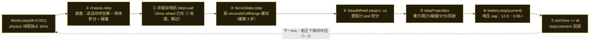
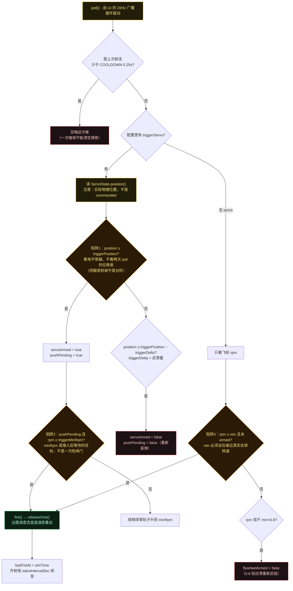
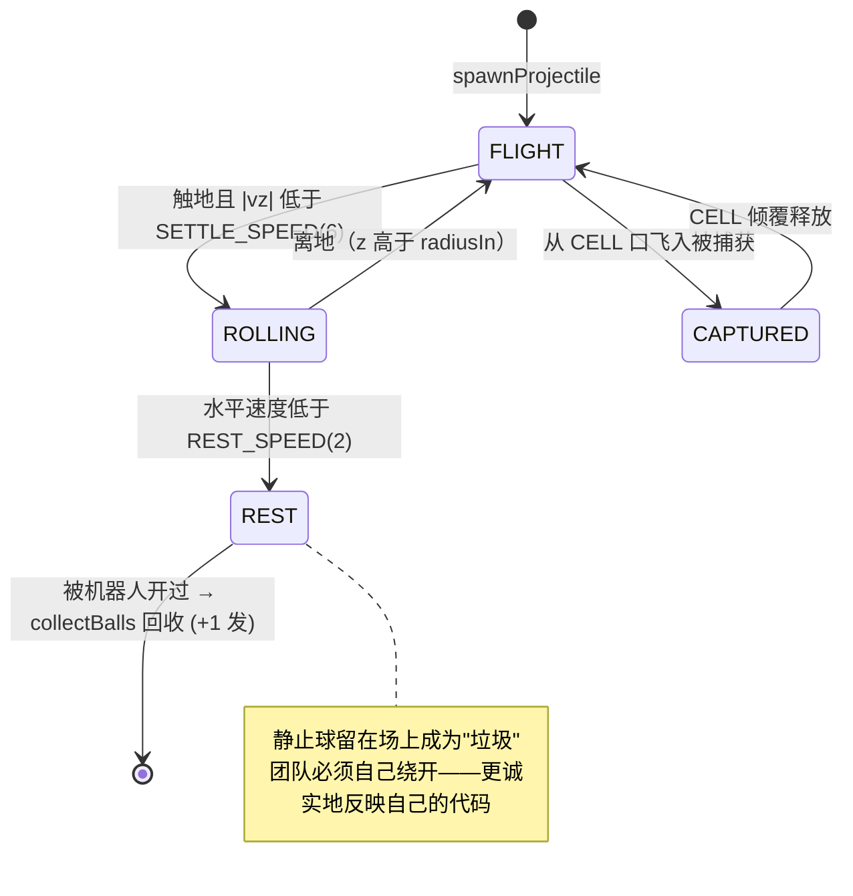

# FTCSim 物理积分与世界（Phase 1 · 第 4 步）

配色：**黄 = 模拟器实现**（ftcsim.*）· **蓝 = 真 SDK** · **绿 = 团队代码** · **灰 = 物理/世界状态** · **紫 = UI 交互注入**。

本步一句话结论：**一个 tick 严格按 7 步推进**（底盘 → 非驱动电机 → 伺服 → 里程计 → 球 → 电池 → 监听回调），底盘是"先给轮子上约束再反问每个轮子有多大力"的约束求解式积分，而**发射是从硬件行为推断出来的**——模拟器从不被告知"我射了"。

## 图 1：一个 tick 里 `World.step` 的严格顺序（`DT = 0.001`，1 kHz）

## 图 2：底盘运动学闭环（`Chassis.step`）

```mermaid
flowchart TB
  subgraph CH["每步 Chassis.step(dt, volts, field)"]
    V["vr = velocityField.rotated(−heading)<br/>+ omega（当前 yaw rate）"] --> IK["逆运动学反解轮 rim 速度<br/>mecanum: rim = vr.x ± vr.y ± k·omega<br/>k = halfWheelBase + halfTrackWidth<br/>tank: 强制无侧向滑移"]
    IK --> SH["shaft = rim / wheelRadius / gearRatio"]
    SH --> OS["motor.observeShaftSpeed(shaft, dt)<br/>直接覆写该轮 omega（约束灌入）"]
    OS --> TQ["motor.torqueStep(dt, volts) → τShaft"]
    TQ --> FO["force = τShaft / gearRatio / wheelRadius"]
    FO --> LM["限幅 ±tractionCoefficient·N/wheel<br/>（打滑上限）"]
    LM --> SM["合成 fx, fy, tz<br/>mecanum / tank 合成式不同"]
    SM --> FR["体摩擦 frictionForce<br/>黏性 −viscous·v + 库仑<br/>静止时只抵消驱动，不反向推"]
    FR --> AC["aRobot = (f+ff)/mass<br/>aField = aRobot.rotated(heading)"]
    AC --> IN["v += aField·dt<br/>omega += (tz+tf)/inertiaZ·dt<br/>pose += v·dt; heading += omega·dt"]
    IN --> CO["resolveCollisions(field)<br/>边界四角推出 + 障碍(圆 r=对角线×0.85)<br/>消法向速度，omega ×= 0.5"]
  end

  classDef sim fill:#211d08,stroke:#eab308,color:#fde68a
  class V,IK,SH,OS,TQ,FO,LM,SM,FR,AC,IN,CO sim
```

要点：这是**先解约束、再积分**。先把速度约束出的轮速灌进电机，再从电机取回它此刻能给多少力；而不是反过来由力推转速。

## 图 3：发射推断决策流（三陷阱都在这张图上）

## 图 4：球的状态机（`Projectile`）

关键常量：`GRAVITY = 9.80665/INCH` · `RESTITUTION = 0.55`（每次弹跳水平再 ×0.86）· `ROLL_DECEL = 45 in/s²` · `MAX_PROJECTILES = 24`（超限先丢已静止的球）· 质量已知时用真实空气阻力 `½ρCdAv²/m`（轻球飞得近），未知时退化为线性阻尼 `DRAG = 0.06`。

> 一个重要次序：`checkGoal` 排在 `hitObstacles` **之前**——因为球门本身也是障碍物，先判进球，否则球会被弹出后再也进不了门。

## UI 交互耦合一览

| UI 动作 | 落到哪里 | 效果 |
|---|---|---|
| launcher 行 pitch 滑块 | `LauncherController.setPitchDeg()`（:52-59） | **运行时覆盖** `spec.pitchDeg`；配置里的 `pitchDeg` 只是滑块起点 |
| 拖动机器人 / reset / snap | `Chassis.teleportEpoch++`（:38,:43-45） | 自增计数，让依赖连续位姿的逻辑知道"世界被瞬移过" |
| 时间缩放滑块 | `World.timeScale`（World.java:49） | physics 步长缩放；另两条周期线程（50Hz）节奏不变 |
| 单步 Step 按钮 | `World.stepFor(s)`（World.java:50-51） | 暂停中开一个 sim-time 预算，走一小段再冻住 |
| launcher poll 驱动 | `broadcastLoop` 20Hz → `poll()` | 发射推断的节拍源（不是 physics 线程） |

## 源码证据

- `sim/src/main/java/ftcsim/physics/World.java:17（DT=0.001）, 87-104（step 顺序）, 47（MAX_PROJECTILES）, 111-127（spawnProjectile）, 147-172（stepProjectiles/collectBalls）, 52-64（timeScale）, 73-80（stepFor）`
- `sim/src/main/java/ftcsim/physics/Chassis.java:15-25（默认参数）, 40（inertiaZ）, 60-133（step）, 136-147（frictionForce）, 149-193（resolveCollisions）, 38-45（teleportEpoch）`
- `sim/src/main/java/ftcsim/hardware/LauncherController.java:15-17（推断哲学）, 121-154（poll 决策/三陷阱）, 83-119（releaseOne）, 25-27（COOLDOWN/DEFAULT_MIN_RPM）, 52-59（pitchOverride）, 182-185（读 ServoState.position）`
- `sim/src/main/java/ftcsim/physics/Projectile.java:73-90（step 顺序）, 97-112（阻力）, 160-184（落地/滚动）, 21-33（常量）`
- `sim/src/main/java/ftcsim/physics/BiobuzzRules.java:145-219（collide/resolveCell/ride，第一批剥离后从 Projectile 移入）`
- `sim/src/main/java/ftcsim/physics/DeadWheel.java:21-30（里程计推算）`
- `sim/src/main/java/ftcsim/physics/Battery.java:14-17（电压 sag）`

配套研究笔记：`notes/research/sim-physics-research-notes.md` 结论 15–19。
