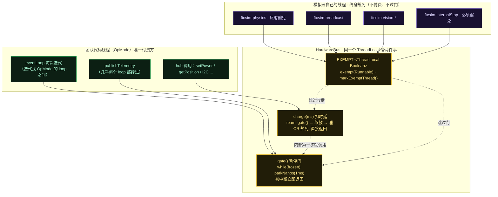
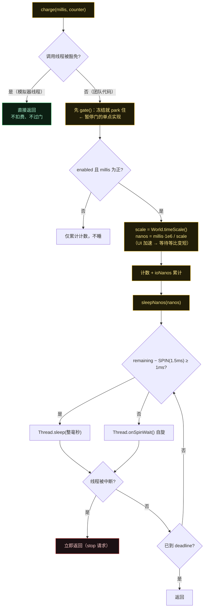
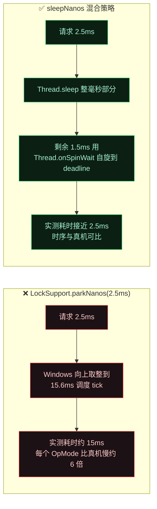

# FTCSim 真实感三件套（Phase 1 · 第 5 步：hub 时序延迟 / 暂停门 / 线程豁免）

配色：**黄 = 模拟器实现**（ HardwareBus / World 等 ftcsim.*）· **绿 = 团队代码**（唯一"付费"的一方）· **紫 = 模拟器自己的豁免线程** · **红 = 会阻塞的危险区域**。

本步一句话结论：**时延收费与暂停门由同一个 `ThreadLocal EXEMPT` 驱动**——只有团队代码线程付费、也只有团队代码线程会被门卡住；而且 `gate()` 是**嵌在 `charge()` 内部**的，所以「机器人代码冻在下一个 hub 调用」是单点实现的。

## 图 1：三件套总览——谁付费、谁豁免、谁被卡

> **为什么 stop 线程必须豁免**：暂停时 OpMode 线程正卡在 `gate()` 里；若 stop 线程也过门，就永远停不掉一个已暂停的 OpMode。

## 图 2：`charge()` —— 一次 hub 事务到底做了什么

**三个 blocking 入口**（共同实现「世界与 OpMode 冻在同一瞬间」）：
1. `charge()` 内部 —— 任何 hub 事务；
2. `SimOpModeRunner` 事件循环每次 pass；
3. `publishTelemetry`。
所以**既不碰硬件也不发 telemetry 的代码会继续跑**，直到触碰这三者之一才被冻住。

## 图 3：为什么不用 `parkNanos` —— Windows 15.6ms scheduler tick 陷阱

同一手法在 physics loop 维持 1kHz 节拍时复用：差值 > 2ms 才 `Thread.sleep`，否则 `Thread.onSpinWait()`。

## 时延常量一览

| hub 事务 | 默认耗时 | 何时扣 |
|---|---|---|
| bulk 读 | 2.0 ms | `LynxModule.bulkRead` 里缓存**刷新**时（`HardwareBus.bulkRead()`） |
| 单次读 | 2.0 ms | bulk caching 为 OFF 时的单次读（`HardwareBus.read()`） |
| 写 | 2.5 ms | `setPower` / `setServoPosition` / `setMode` 等每次写（`HardwareBus.write()`） |
| I2C | 2.5 ms | I2C 设备事务（`HardwareBus.i2c()`） |

> **命中缓存时不扣费**：bulk caching 为 MANUAL/AUTO 且未触发刷新时，只调 `gate()`（过门）不扣时延——所以 bulk caching 在模拟器里同样能提速，与真机同构。

## 三个角色的差异总表

| 线程 | 付 hub 时延 | 过暂停门 | 理由 |
|---|---|---|---|
| 团队 OpMode 线程 | ✅ 付 | ✅ 过 | 它就是要被模拟成"在真机上跑"的那一方 |
| `ftcsim-physics` | ❌ 免 | ❌ 免（自己判 `frozen()` 自停） | 推 tick 的人不能被冻结，否则世界永不前进 |
| `ftcsim-broadcast` | ❌ 免 | ❌ 免 | UI 要能在暂停时继续读快照（否则暂停后 UI 卡死） |
| `ftcsim-vision-*` | ❌ 免 | ❌ 免 | 视觉线程，同理 |
| `ftcsim-internalStop` | ❌ 免 | ❌ 免 | 否则暂停时 OpMode 永远停不掉 |

> `World.markPhysicsThread()` 用**反射**调用 `HardwareBus.markExemptThread()`（`World.java:281-283`）——因为 `ftcsim.physics` 包不该反向依赖 `ftcsim.hardware` 包，用反射打破包循环依赖。

## 源码证据

- `sim/src/main/java/ftcsim/hardware/HardwareBus.java:23（时延常量）, 30（EXEMPT ThreadLocal）, 55-63（exempt/markExemptThread）, 65-83（write/read/bulkRead/i2c + charge）, 85-94（gate）, 96-121（sleepNanos 混合策略与注释）`
- `sim/src/main/java/ftcsim/physics/World.java:67（frozen）, 70-77（stepFor/stepRemaining）, 285-319（loop：frozen 自停 / catchUp&lt;50 / sleep-spin）, 280-283（反射豁免）`
- `sim/src/main/java/com/qualcomm/robotcore/eventloop/opmode/SimOpModeRunner.java:186（stop 豁免）, 301-305（eventLoop gate）, 345-348（publishTelemetry gate）`
- `sim/src/main/java/com/qualcomm/hardware/lynx/LynxModule.java:120-147（isExempt 直读 live + 三条扣费路径）`
- `sim/src/main/java/ftcsim/Simulator.java:130（broadcast 豁免）`
- `sim/src/main/java/org/firstinspires/ftc/vision/VisionPortalImpl.java:79（vision 豁免）`

配套研究笔记：`notes/research/sim-physics-research-notes.md` 结论 20–23。
