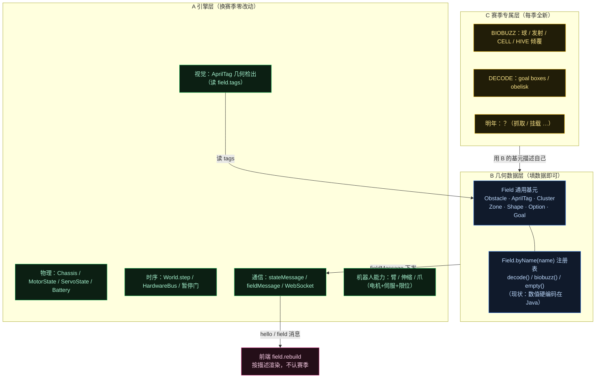
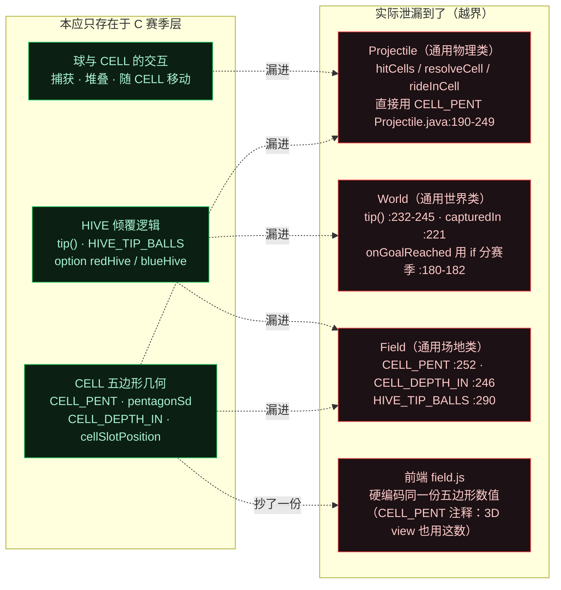
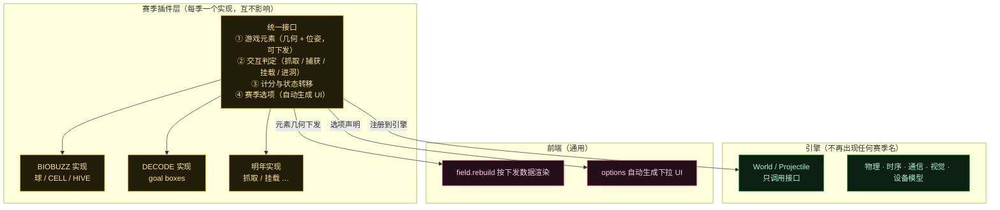
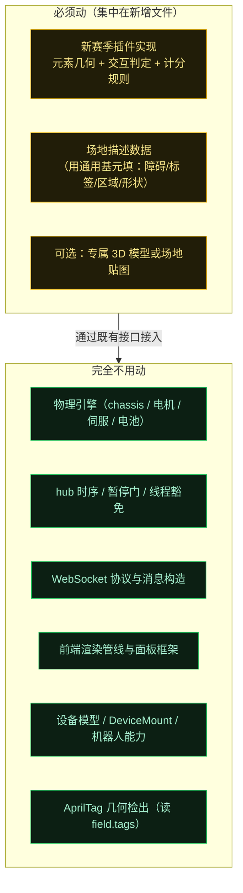

# 赛季可复用性分层图（通用引擎 / 几何数据 / 赛季插件）

> 背景：每季场地会大变样（26 年是投球 + CELL + HIVE；24 年是抓取零件挂上去；明年未知）。
> 本文回答一个问题：**换赛季时，哪些代码能不动、哪些必须动，以及"必须动"的部分如何收敛到最小范围。**

核心结论：**变的从来不是"机器人怎么动"，而是"场上那个东西怎么被操作、怎么算得分"**。前者是通用能力（电机 + 伺服 + 限位，早已具备），后者才是每季全新的部分。

> **状态（2026-10-25）**：两批剥离均已落地。第一批新增 `SeasonRules`（引擎调用的赛季行为接口）与 `BiobuzzRules`；第二批补齐 `tipPoints`/`scoreEventLabel`/`isTagVisible`、`DecodeRules`、`Map` 注册表与 `Field.nameFromHint`，`Simulator` 改为通用 `field.event` 并按 `rules()` 过滤标签，前端去掉 `hive.tip`/`sim.obelisk`/fallback 常量。引擎统一经 `field.rules()` 调用。**尚未做**：公共 `SeasonGame` 插件接口（附录 A 的完整形态）、把场地几何从 Java 字面量搬到数据文件。下文图 2 与「泄漏点清单」保留为剥离前的记录。

---

## 图 1：三层划分与正常数据流



**关键**：`Field.byName(name)` 这个注册表（`Field.java` 的 `FACTORIES`）**已经就位**——加新赛季 = 注册一个工厂。而且选哪个场地是配置驱动的：`Simulator.java` 会先按机器人配置名用 `Field.nameFromHint` 匹配赛季名，配置里的 `field` 仍然优先。

---

## 图 2：第一批剥离前的「泄漏」（历史记录，已在 2026-10-25 处理）

理想情况下 C 层代码不该出现在 A 层的类里，剥离前有几处越界。下面保留原图，便于对照第一批改了什么；当前代码里 P0/P1 的几何与规则已不在 `Projectile`/`World`/`Field`。



**最典型的两句话**（读代码时能直接看到赛季名出现在通用类里）：

- `World.onGoalReached` 的注释（`World.java:180`）：*"A DECODE goal scores; a BIOBUZZ CELL is a box, not a hit box"*——通用方法里用分支区分赛季。
- `Projectile.hitCells` 的注释（`Projectile.java:190-194`）：*"The BIOBUZZ CELLS: boxes, not hit boxes…"*——通用物理类直接实现某赛季元素的碰撞。

---

## 图 3：剥离后的目标形态（插件化）



这样，明年的改动就是**新增一个插件实现**，而不是去 `Projectile` 里删掉去年的五边形、去 `World` 里改倾覆逻辑。

---

## 图 4：明年换赛季时的改动范围



**特别提醒**：机器人的"伸缩 + 抓取"这类能力**根本不需要新物理**——
- 伸缩臂/升降 = 非驱动电机（`MotorState.stepLoad` + 惯性/摩擦/重力/限位），**第 2 步已具备**；
- 行程限位 = `minAngle / maxAngle`（`applyLimits`），**已有**；
- 爪子 = 伺服（`ServoState` 位置/CR 模式），**第 3 步已具备**。

所以 24 年那种"抓取零件挂上去"的需求，在**机器人侧是现成的**，要新写的只有"那个零件和 backdrop 的几何 + 交互判定"。

---

## 泄漏点清单与处理优先级

| 优先级 | 泄漏点 | 状态 | 现在的位置 / 剩余工作 |
|---|---|---|---|
| **P0** | CELL 五边形碰撞写在通用物理类 | **已剥离** | `BiobuzzRules.collide` / `resolveCell`；`Projectile.step` 只调 `field.rules().collide(this, field)` |
| **P0** | HIVE 倾覆写在通用世界类 | **已剥离** | `BiobuzzRules.afterStep` / `capture` / `tip` / `release`；`World` 只调 `field.rules().afterStep(p, this)`，并提供 `markFieldChanged()` |
| **P1** | 赛季常量写在通用 `Field` | **已剥离** | `BiobuzzRules.CELL_*` / `HIVE_*` / `cellSlotPosition` / `cellGeometry`；`Field` 只留通用基元 |
| **P1** | 前后端各存一份几何数值 | **已完成** | 后端单源 `BiobuzzRules.cellGeometry()` 经 `fieldMessage` 下发；`field.js` 只读下发值，fallback 常量已删除 |
| **P2** | 场地几何手工转录、硬编码在 Java | 未做 | `Field.biobuzz()` 数据仍是 Java 字面量 |
| **P1** | 注册表与赛季身份 | **已完成** | `Field.byName` 改为 `FACTORIES` 表 + `register()`；`nameFromHint()` 取代 `contains("biobuzz")` |
| **P1** | 计分与工具链仍认赛季 | **已完成** | `Simulator` 用 `rules.tipPoints()`/`scoreEventLabel()` 发通用 `field.event`；obelisk 过滤移入 `DecodeRules.isTagVisible()`；不再有 `sim.obelisk` |
| **P1** | 前端文案与赛季分支 | **已完成** | `renderFieldOptions` + 通用 `field.event` toast；2D 不再特判 `DECODE`/obelisk |
| — | 场地贴图按赛季各一份 | 保持 | `FieldImages`（DECODE/BIOBUZZ png）合理 |

## 务实建议

第一批已经按「只动位置、不动契约」完成，验收标准是现有测试断言不变：

- 引擎只新增一个很小的 `SeasonRules` 接口；BIOBUZZ 的全部几何/规则集中在 `BiobuzzRules`。
- `capturedIn`、`State.CAPTURED`、`tipEvents/tipCounts` 这些 **UI 契约字段没有动**，所以 `Simulator.ballsMessage()` 与前端无需改。
- 第二笔已完成：`Map` 注册表、`Simulator` 计分/obelisk 收敛、前端文案与 fallback 清理。通用协议事件 `field.event {event,label,count,points}` 取代了 `hive.tip`；`SeasonRules` 新增 `tipPoints()`/`scoreEventLabel()`/`isTagVisible()`，公开的 `SeasonGame` 插件接口仍留在附录 A 作为可选演进。

## 源码证据（第一批之后）

- 引擎接口：`physics/SeasonRules.java`（`collide` / `ride` / `afterStep` / `isScoringGoal` / `isTagVisible` / `tipPoints` / `scoreEventLabel` / `resetFieldState` / `extraFieldData`）
- 赛季实现：`physics/BiobuzzRules.java`（五边形、CELL 碰撞、捕获/堆放、tip/release、20 分、`cellGeometry`、场地构建）；`physics/DecodeRules.java`（只让选中的 obelisk 面可见）
- 通用引擎调用点：`Projectile.step`（`field.rules().ride/collide`）、`World.stepProjectiles`（`afterStep`）、`World.clearProjectiles`（`resetFieldState`）、`Simulator.fieldMessage`（`extraFieldData` + `isTagVisible`）、`Simulator.drainFieldEvents`（`tipPoints`/`scoreEventLabel`）、`SimVision`/`Limelight3A`/`AprilTagProcessorImpl`（`isTagVisible`）
- 注册表与切换：`Field.FACTORIES` + `Field.register(name, factory)`；`Field.nameFromHint(text)` 供 `Simulator` 从配置名猜赛季；`World` 默认 `Field.decode()`
- 通用能力已具备：`MotorState.stepLoad/applyLimits`；`ServoState` 位置/CR 模式
- 前端：`main.js` 的 `field.rebuild` 通用重建、`renderFieldOptions` 按 options 自动生成 UI、`field.event` 通用 toast；`field.js` 只使用下发的 `cellGeometry`，无 fallback

---

## 附录 A：赛季插件接口签名（`SeasonGame`）

下面把图 3 的"统一接口 ①几何 ②交互 ③计分 ④选项"落成可落地的 Java 签名。每个赛季一个实现，挂在它自己构造的 `Field` 上；通用引擎只通过接口调用，不再出现赛季名 / 几何。

> **注意**：这是完整目标形态，尚未落地。实际落地的是更小的 `SeasonRules`（`collide` / `ride` / `afterStep` / `isScoringGoal` / `isTagVisible` / `tipPoints` / `scoreEventLabel` / `resetFieldState` / `extraFieldData`），实现为 `BiobuzzRules` / `DecodeRules`（默认实现供 `Empty` 等使用）；注册表 `Field.FACTORIES` 已就位，但没有 `buildField()` 和独立的 `SeasonGame` 对象。

```java
package ftcsim.physics;

/** 赛季游戏插件：场地几何 + 投射物交互 + 计分状态转移 + 赛季选项。 */
public interface SeasonGame {
    // ── 注册 / 标识 ──
    String name();                 // "DECODE" | "BIOBUZZ" | "EMPTY"

    // ── 场地数据（原 Field.decode()/biobuzz()/buildHives()）
    Field buildField();            // 全部 Obstacle/Zone/Shape/Option/Cluster/Tag/Goal + 挂 this
    void resetFieldState(Field f); // 比赛开始：原 Field.resetHives() 语义；EMPTY 为空实现

    // ── 投射物每一步的交互（原 Projectile.hitCells/resolveCell）
    void collide(Projectile p, Field f);   // 在 Projectile.step 中取代 hitCells；DECODE 为空

    // ── 进球/捕获判定（取代 World.onGoalReached 的 if 分赛季）
    /** 球进入某 goal 后的赛季裁决。返回 SCORE（计入 scoreEvents）/ IGNORE。 */
    GoalOutcome resolveGoalReached(String goalName, Projectile p, Field f);

    // ── 捕获（取代 World.checkCellCapture/enteringMouth/capture）
    /** 返回应捕获到的 Cluster，或 null。 */
    Field.Cluster tryCapture(Projectile p, Field f);
    void onCaptured(Projectile p, Field.Cluster cell, World w);  // 分配 slot、达阈值触发 tip

    // ── HIVE 倾覆（取代 World.tip/release + Field.HIVE_TIP_BALLS）
    boolean shouldTip(String cellName, World w);     // 阈值判定（原 capturedIn>=HIVE_TIP_BALLS）
    void tip(String cellName, World w);              // 翻转选项 + 释放球 + 发 tipEvents
    void releaseCaptured(Projectile p, Field.Cluster cell);  // 原 World.release

    // ── 计分（取代 Simulator 里硬编码的 20 分）
    int tipPoints();                 // BIOBUZZ: 20；DECODE: 0

    // ── 选项声明（自动生成 UI 下拉，原 Field.biobuzz 里的 Option 可移到这里或仍留 buildField）
}
```

配套判定值对象：

```java
enum GoalOutcome { SCORE, IGNORE }
// CAPTURE 用带簇名的重载 / 记录：record Capture(String clusterName) {}
```

**调用时机（第一批已按此落地；`SeasonGame` 是后续扩展）**：

- `Projectile.step(dt, f)` → 捕获态先 `field.rules().ride(p, f)`，普通碰撞调用 `field.rules().collide(p, f)`。
- `World.stepProjectiles` → 进球裁决 `field.rules().isScoringGoal(name, f)`，捕获 `field.rules().afterStep(p, this)`。
- `World.clearProjectiles` → `field.rules().resetFieldState(field)`。
- `BiobuzzRules.tip` → `World.markFieldChanged()`。
- `Simulator.fieldMessage` → `field.rules().extraFieldData()`（BIOBUZZ 下发 `cellGeometry`）。
- `Simulator.drainFieldEvents` → `rules.tipPoints()` / `rules.scoreEventLabel()` 构造 `field.event`。
- `Simulator.fieldMessage` → 只下发 `isTagVisible()` 为真的标签。
- `Field.nameFromHint` → 配置名猜赛季；显式 `config.field` 仍然优先。

## 附录 B：数据模型与挂载方式

**现状**：`Field.byName` 查 `FACTORIES`（`LinkedHashMap<String, Supplier<Field>>`，`register()` 可扩展），每个值调一个静态工厂（`decode()`/`empty()`/`biobuzz()`）；`World.java` 默认 `Field.decode()`，`Simulator` 用 `Field.nameFromHint(configName)` 先猜、再用 `config.field` 覆盖。`configs/*.json` 的 `field` 字段是字符串（`"DECODE"` / `"biobuzz"`）。

**建议改造**：

1. 引入 `interface SeasonGame` 与其实现 `DecodeGame` / `BiobuzzGame` / `EmptyGame`。**不要**把实现放进 `ftcsim.physics.season/` 同时用包级字段：Java 子包不是同包。当前用同包 `BiobuzzRules`/`DecodeRules` + public `Field.rules()` 绕开了这个问题；若要拆子包，必须把访问器改成 public。
2. `Field` 持有 `SeasonRules rules`（已实现）并提供 public `rules()`；通用引擎（Projectile/World/Simulator/视觉）一律经它取赛季行为，不再直接触碰赛季常量。
3. 注册表已从 `switch` 改为 `Map<String, Supplier<Field>>`，`byName` 查表；新增赛季 = `register` 一行，不改 `Projectile/World`。**已完成**。
4. 赛季几何常量已随 `BiobuzzRules` 搬走，`pentagonSd/pentagonClosest/cellSlotPosition/cellGeometry` 也在那里；`Field` 不再有 `CELL_*`/`HIVE_*`。
5. **前端去重已完成**：`field.js` 只用下发的 `cellGeometry`，fallback 常量已删；事件与文案由通用的 `field.event` 承载。

## 附录 C：迁移步骤（按风险 / 依赖排序，纯挪位置优先）

| 步 | 目标 | 状态（2026-10-25） |
|---|---|---|
| **0. 先固化测试** | `HiveTipTest` / `BioBuzzFieldTest` / `ProjectileTest` 全绿 | **已满足**：65/65 通过 |
| **1. 抽规则接口 + 实现** | 同包 `SeasonRules` + `BiobuzzRules`，`Field.rules()` | **已完成**（第一批） |
| **2. 搬赛季常量与几何辅助** | `CELL_*`/`HIVE_*`/`pentagon*`/`cellSlotPosition`/`cellGeometry` 从 `Field` 移到 `BiobuzzRules` | **已完成**；测试改为引用 `BiobuzzRules.CELL_DEPTH_IN/HIVE_TIP_BALLS` |
| **3. 搬 CELL 碰撞 / 捕获 / 随动** | `collide/resolveCell`、`afterStep/capture`、`ride` | **已完成**；`Projectile`/`World` 只调 `field.rules()` |
| **4. 搬 HIVE 倾覆与复位** | `tip/release`、`resetFieldState`、`markFieldChanged` | **已完成**；计分改由 `rules.tipPoints()` 提供 |
| **5. 去前端双份几何** | 后端 `cellGeometry` 下发 + 前端读取 | **已完成**；`field.js` 无 fallback，文案走 `field.event` |
| **6. 收敛配置选赛季** | `contains("biobuzz")` 启发式、`Simulator` obelisk 特判 | **已完成**：`nameFromHint` + `isTagVisible`（第二笔） |
| **7. 落地 FieldImages 索引** | 按 `SeasonRules`/赛季名取 png | 保持现状 |

> 风险修正：原文把步 1–4 统称「低风险」。实际只有步 1–3 的“同包搬位置”接近低风险；步 4 涉及 `fieldChanged`、事件队列和复位，属于中风险。第一批通过 **不改变 `capturedIn`/`tipEvents`/`tipCounts` 这些 UI 契约** 把风险压了下来。

## 附录 D：补充的泄漏点（Simulator 与前端，原清单未点名）

第二笔已全部处理：

- `Simulator.drainFieldEvents` 用 `field.rules().tipPoints()` / `scoreEventLabel()` 发送通用 `field.event {event,label,count,points}`，不再出现 `20` 硬编码。
- `Simulator` 用 `Field.nameFromHint(c.name)` 取代 `contains("biobuzz")`。
- `Simulator` 不再处理 `sim.obelisk`；`DecodeRules.isTagVisible()` 统一决定标签 21–23 中哪一面在场，`SimVision`/`Limelight3A`/`AprilTagProcessorImpl` 都经 `rules()` 过滤。
- 前端：`3d/main.js` 的 `renderFieldOptions` 生成所有赛季选项，`field.event` → `onFieldEvent` 使用后端下发的 `label`/`points`；`2d/app.js` 不再特判 `DECODE`/obelisk。
- `3d/field.js` 的 CELL/HIVE fallback 常量已删除；没有 `cellGeometry` 时不画 HIVE。

## 附录 E：测试锚定（迁移"不得破坏"的回归基线）

- `HiveTipTest.java`：捕获 / 倾覆 / 复位 / DECODE 仍进球；常量引用改为 `BiobuzzRules.CELL_DEPTH_IN` / `HIVE_TIP_BALLS`，断言未改。
- `BioBuzzFieldTest.java`：4 个 CELL 簇、标签 30-45、倾角 ±30°、倾覆交换、byName/nameFromHint 选择、仅选中 obelisk 面可见、20 分与事件文案。
- `ProjectileTest.java`：通用物理，用 `Field.decode()`，**不含赛季**（纯通用，可保留）。
- 验收（2026-10-25 第二轮）：`./gradlew :sim:test` 65/65、`node tools/check-web.mjs` 11/11、`node tools/docs-check.mjs` 无 drift；本机 Playwright（Chromium + SwiftShader）验证 BIOBUZZ field 消息（含 `cellGeometry`）、2 组 HIVE / 4 个 CELL / 16 个 tag 渲染、`redHive` 切换、`sim.clearBalls` 复位、`field.event` toast（`RED HIVE tipped — +20 pts`），无 page/console error。
