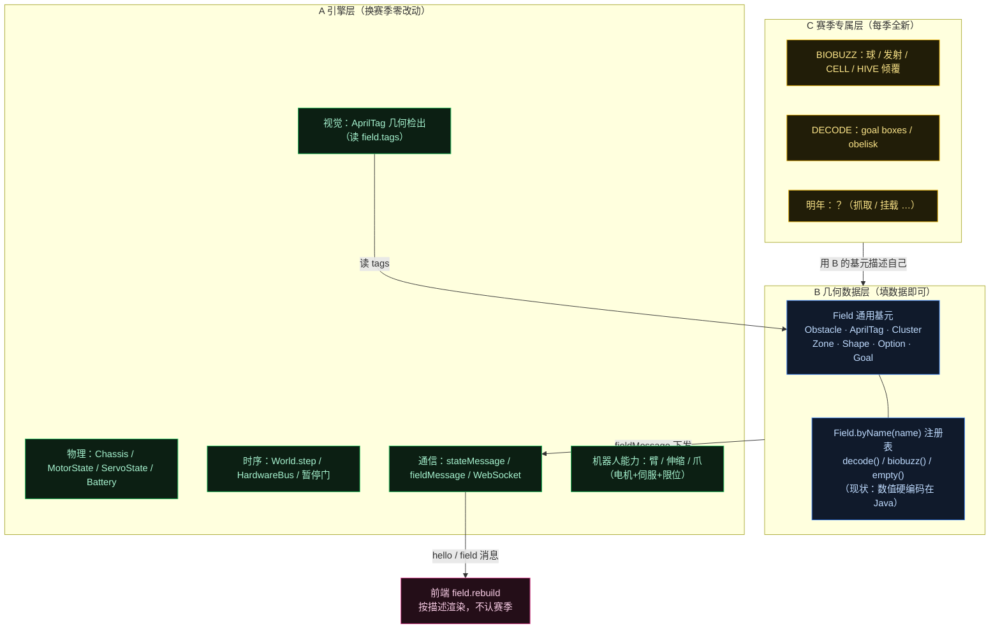
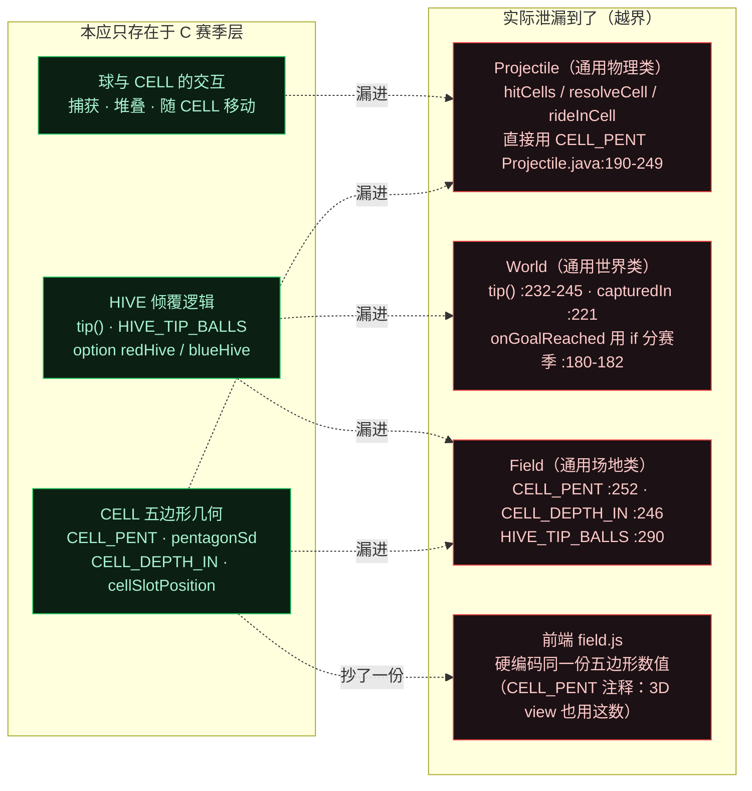
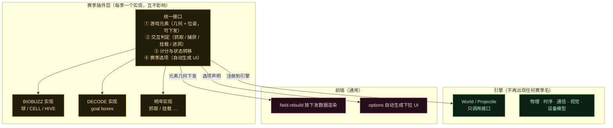
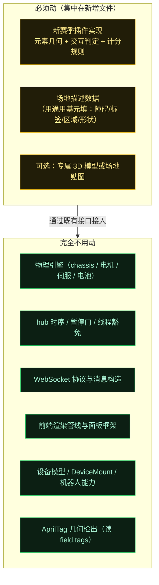

# 赛季可复用性分层图（通用引擎 / 几何数据 / 赛季插件）

> 背景：每季场地会大变样（26 年是投球 + CELL + HIVE；24 年是抓取零件挂上去；明年未知）。
> 本文回答一个问题：**换赛季时，哪些代码能不动、哪些必须动，以及"必须动"的部分如何收敛到最小范围。**

核心结论：**变的从来不是"机器人怎么动"，而是"场上那个东西怎么被操作、怎么算得分"**。前者是通用能力（电机 + 伺服 + 限位，早已具备），后者才是每季全新的部分。

---

## 图 1：三层划分与正常数据流

**关键**：`Field.byName(name)` 这个注册表（`Field.java:170-177`）**已经就位**——加新赛季 = 加一个 `case` + 一个工厂方法。而且选哪个场地是配置驱动的：`Simulator.java:157` 会按机器人配置名自动匹配（`contains("biobuzz")` → `BIOBUZZ`）。

---

## 图 2：现状的「泄漏」——C 的代码混进了 A（本图是重点）

理想情况下 C 层代码不该出现在 A 层的类里，但目前有几处越界。红色是需要优先处理的部分。

**最典型的两句话**（读代码时能直接看到赛季名出现在通用类里）：

- `World.onGoalReached` 的注释（`World.java:180`）：*"A DECODE goal scores; a BIOBUZZ CELL is a box, not a hit box"*——通用方法里用分支区分赛季。
- `Projectile.hitCells` 的注释（`Projectile.java:190-194`）：*"The BIOBUZZ CELLS: boxes, not hit boxes…"*——通用物理类直接实现某赛季元素的碰撞。

---

## 图 3：剥离后的目标形态（插件化）

这样，明年的改动就是**新增一个插件实现**，而不是去 `Projectile` 里删掉去年的五边形、去 `World` 里改倾覆逻辑。

---

## 图 4：明年换赛季时的改动范围

**特别提醒**：机器人的"伸缩 + 抓取"这类能力**根本不需要新物理**——
- 伸缩臂/升降 = 非驱动电机（`MotorState.stepLoad` + 惯性/摩擦/重力/限位），**第 2 步已具备**；
- 行程限位 = `minAngle / maxAngle`（`applyLimits`），**已有**；
- 爪子 = 伺服（`ServoState` 位置/CR 模式），**第 3 步已具备**。

所以 24 年那种"抓取零件挂上去"的需求，在**机器人侧是现成的**，要新写的只有"那个零件和 backdrop 的几何 + 交互判定"。

---

## 泄漏点清单与处理优先级

| 优先级 | 泄漏点 | 位置 | 建议 |
|---|---|---|---|
| **P0** | CELL 五边形碰撞写在通用物理类 | `Projectile.java:190-249`（`hitCells`/`resolveCell`/`rideInCell`） | 抽到赛季插件，`Projectile` 只保留通用质点物理 |
| **P0** | HIVE 倾覆写在通用世界类 | `World.java:180-182`（if 分赛季）、`:232-245`（`tip`） | 抽到赛季插件，阈值与效果参数化 |
| **P1** | 赛季常量写在通用 `Field` | `Field.java:246/252/290`（`CELL_*`、`CELL_PENT`、`HIVE_TIP_BALLS`） | 随插件搬走，`Field` 只留通用基元 |
| **P1** | 前后端各存一份几何数值 | `Field.CELL_PENT` 与前端 `field.js` | 只留一份在后端，经 `fieldMessage` 下发 |
| **P2** | 场地几何手工转录、硬编码在 Java | `biobuzz()` 注释：转录自社区文档 | 考虑改为资源文件（数据驱动），降低每季录入成本 |
| — | 场地贴图按赛季各一份 | `FieldImages`（DECODE/BIOBUZZ png） | 合理，保持现状即可 |

## 务实建议

**现在不必为明年做过度设计**——明年的场地和玩法都未知，提前抽象很容易抽象错。但有**一件低成本高回报的事**值得现在做：

> 把已泄漏到 `Projectile` / `World` 里的 BIOBUZZ 代码**先剥出去**（纯挪位置，不改功能，风险低）。

好处是：明年新赛季的改动会集中在一个新文件，而不是面对一个已被赛季代码污染过的 `Projectile`。这比"等明年一起大改"省事得多。

## 源码证据

- 场地注册表与切换：`Field.java:170-177`（`byName(name)`）、`:208`（`decode`）、`:230`（`empty`）、`:293`（`biobuzz`）；`Simulator.java:157`（按配置名自动选）；`World.java:20`（默认 `decode()`）
- 赛季常量泄漏：`Field.java:246`（`CELL_DEPTH_IN`/`CELL_BOTTOM_IN`）、`:252-253`（`CELL_PENT`）、`:260-286`（`pentagonSd`/`pentagonClosest`）、`:190-195`（`cellSlotPosition`）、`:290`（`HIVE_TIP_BALLS`）
- 物理层越界：`Projectile.java:190-249`（CELL 碰撞/捕获/随动）、`:252-258`（`rideInCell`）
- 世界层越界：`World.java:180-182`（`onGoalReached` 分赛季）、`:216-225`（`checkCellCapture`/`capturedIn`）、`:232-245`（`tip`）
- 通用能力已具备：`MotorState.java:183-198`（`stepLoad` 含惯性/摩擦/重力）、`:200-203`（`applyLimits` 行程限位）；`ServoState.java:40-57`（位置/CR 模式）
- 前端：`main.js:118/128`（`field.rebuild` 通用重建）、`:317-349`（`renderBioBuzz` 按 options 自动生成 UI）
