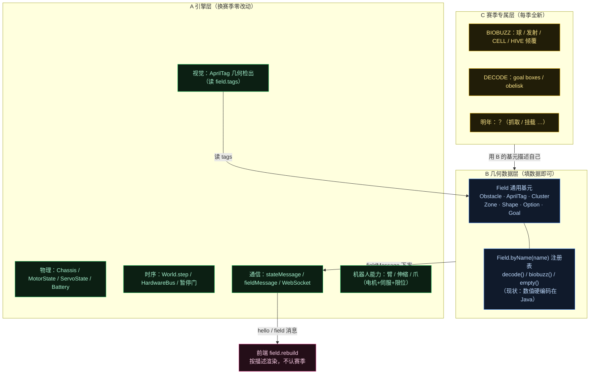
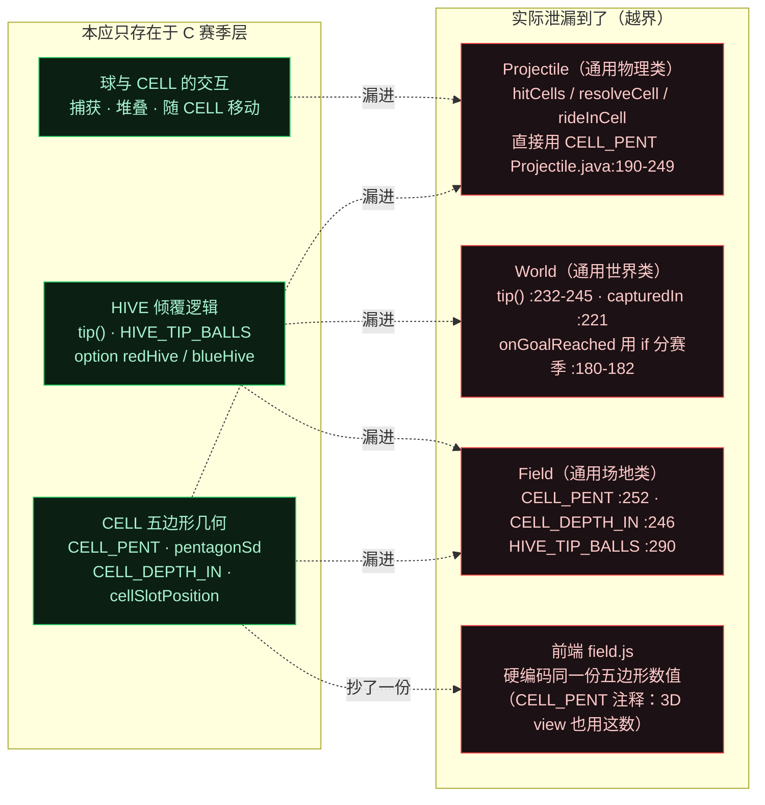
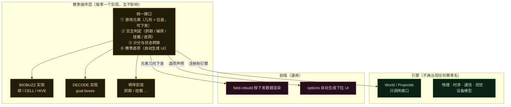
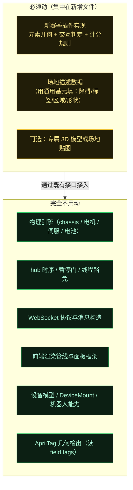

# 赛季可复用性分层图（通用引擎 / 几何数据 / 赛季插件）

> 背景：每季场地会大变样（26 年是投球 + CELL + HIVE；24 年是抓取零件挂上去；明年未知）。
> 本文回答一个问题：**换赛季时，哪些代码能不动、哪些必须动，以及"必须动"的部分如何收敛到最小范围。**

核心结论：**变的从来不是"机器人怎么动"，而是"场上那个东西怎么被操作、怎么算得分"**。前者是通用能力（电机 + 伺服 + 限位，早已具备），后者才是每季全新的部分。

---

## 图 1：三层划分与正常数据流



**关键**：`Field.byName(name)` 这个注册表（`Field.java:170-177`）**已经就位**——加新赛季 = 加一个 `case` + 一个工厂方法。而且选哪个场地是配置驱动的：`Simulator.java:157` 会按机器人配置名自动匹配（`contains("biobuzz")` → `BIOBUZZ`）。

---

## 图 2：现状的「泄漏」——C 的代码混进了 A（本图是重点）

理想情况下 C 层代码不该出现在 A 层的类里，但目前有几处越界。红色是需要优先处理的部分。



**最典型的两句话**（读代码时能直接看到赛季名出现在通用类里）：

- `World.onGoalReached` 的注释（`World.java:180`）：*"A DECODE goal scores; a BIOBUZZ CELL is a box, not a hit box"*——通用方法里用分支区分赛季。
- `Projectile.hitCells` 的注释（`Projectile.java:190-194`）：*"The BIOBUZZ CELLS: boxes, not hit boxes…"*——通用物理类直接实现某赛季元素的碰撞。

---

## 图 3：剥离后的目标形态（插件化）



这样，明年的改动就是**新增一个插件实现**，而不是去 `Projectile` 里删掉去年的五边形、去 `World` 里改倾覆逻辑。

---

## 图 4：明年换赛季时的改动范围



**特别提醒**：机器人的"伸缩 + 抓取"这类能力**根本不需要新物理**——
- 伸缩臂/升降 = 非驱动电机（`MotorState.stepLoad` + 惯性/摩擦/重力/限位），**第 2 步已具备**；
- 行程限位 = `minAngle / maxAngle`（`applyLimits`），**已有**；
- 爪子 = 伺服（`ServoState` 位置/CR 模式），**第 3 步已具备**。

所以 24 年那种"抓取零件挂上去"的需求，在**机器人侧是现成的**，要新写的只有"那个零件和 backdrop 的几何 + 交互判定"。

---

## 泄漏点清单与处理优先级

| 优先级 | 泄漏点 | 位置 | 建议 |
|---|---|---|---|
| **P0** | CELL 五边形碰撞写在通用物理类 | `Projectile.java:190-249`（`hitCells`/`resolveCell`/`rideInCell`） | 抽到赛季插件，`Projectile` 只保留通用质点物理 |
| **P0** | HIVE 倾覆写在通用世界类 | `World.java:180-182`（if 分赛季）、`:232-245`（`tip`） | 抽到赛季插件，阈值与效果参数化 |
| **P1** | 赛季常量写在通用 `Field` | `Field.java:246/252/290`（`CELL_*`、`CELL_PENT`、`HIVE_TIP_BALLS`） | 随插件搬走，`Field` 只留通用基元 |
| **P1** | 前后端各存一份几何数值 | `Field.CELL_PENT` 与前端 `field.js` | 只留一份在后端，经 `fieldMessage` 下发 |
| **P2** | 场地几何手工转录、硬编码在 Java | `biobuzz()` 注释：转录自社区文档 | 考虑改为资源文件（数据驱动），降低每季录入成本 |
| — | 场地贴图按赛季各一份 | `FieldImages`（DECODE/BIOBUZZ png） | 合理，保持现状即可 |

## 务实建议

**现在不必为明年做过度设计**——明年的场地和玩法都未知，提前抽象很容易抽象错。但有**一件低成本高回报的事**值得现在做：

> 把已泄漏到 `Projectile` / `World` 里的 BIOBUZZ 代码**先剥出去**（纯挪位置，不改功能，风险低）。

好处是：明年新赛季的改动会集中在一个新文件，而不是面对一个已被赛季代码污染过的 `Projectile`。这比"等明年一起大改"省事得多。

## 源码证据

- 场地注册表与切换：`Field.java:170-177`（`byName(name)`）、`:208`（`decode`）、`:230`（`empty`）、`:293`（`biobuzz`）；`Simulator.java:157`（按配置名自动选）；`World.java:20`（默认 `decode()`）
- 赛季常量泄漏：`Field.java:246`（`CELL_DEPTH_IN`/`CELL_BOTTOM_IN`）、`:252-253`（`CELL_PENT`）、`:260-286`（`pentagonSd`/`pentagonClosest`）、`:190-195`（`cellSlotPosition`）、`:290`（`HIVE_TIP_BALLS`）
- 物理层越界：`Projectile.java:190-249`（CELL 碰撞/捕获/随动）、`:252-258`（`rideInCell`）
- 世界层越界：`World.java:180-182`（`onGoalReached` 分赛季）、`:216-225`（`checkCellCapture`/`capturedIn`）、`:232-245`（`tip`）
- 通用能力已具备：`MotorState.java:183-198`（`stepLoad` 含惯性/摩擦/重力）、`:200-203`（`applyLimits` 行程限位）；`ServoState.java:40-57`（位置/CR 模式）
- 前端：`main.js:118/128`（`field.rebuild` 通用重建）、`:317-349`（`renderBioBuzz` 按 options 自动生成 UI）

---

## 附录 A：赛季插件接口签名（`SeasonGame`）

下面把图 3 的"统一接口 ①几何 ②交互 ③计分 ④选项"落成可落地的 Java 签名。每个赛季一个实现，挂在它自己构造的 `Field` 上；通用引擎只通过接口调用，不再出现赛季名 / 几何。

```java
package ftcsim.physics;

/** 赛季游戏插件：场地几何 + 投射物交互 + 计分状态转移 + 赛季选项。 */
public interface SeasonGame {
    // ── 注册 / 标识 ──
    String name();                 // "DECODE" | "BIOBUZZ" | "EMPTY"

    // ── 场地数据（原 Field.decode()/biobuzz()/buildHives()）
    Field buildField();            // 全部 Obstacle/Zone/Shape/Option/Cluster/Tag/Goal + 挂 this
    void resetFieldState(Field f); // 比赛开始：原 Field.resetHives() 语义；EMPTY 为空实现

    // ── 投射物每一步的交互（原 Projectile.hitCells/resolveCell）
    void collide(Projectile p, Field f);   // 在 Projectile.step 中取代 hitCells；DECODE 为空

    // ── 进球/捕获判定（取代 World.onGoalReached 的 if 分赛季）
    /** 球进入某 goal 后的赛季裁决。返回 SCORE（计入 scoreEvents）/ IGNORE。 */
    GoalOutcome resolveGoalReached(String goalName, Projectile p, Field f);

    // ── 捕获（取代 World.checkCellCapture/enteringMouth/capture）
    /** 返回应捕获到的 Cluster，或 null。 */
    Field.Cluster tryCapture(Projectile p, Field f);
    void onCaptured(Projectile p, Field.Cluster cell, World w);  // 分配 slot、达阈值触发 tip

    // ── HIVE 倾覆（取代 World.tip/release + Field.HIVE_TIP_BALLS）
    boolean shouldTip(String cellName, World w);     // 阈值判定（原 capturedIn>=HIVE_TIP_BALLS）
    void tip(String cellName, World w);              // 翻转选项 + 释放球 + 发 tipEvents
    void releaseCaptured(Projectile p, Field.Cluster cell);  // 原 World.release

    // ── 计分（取代 Simulator 里硬编码的 20 分）
    int tipPoints();                 // BIOBUZZ: 20；DECODE: 0

    // ── 选项声明（自动生成 UI 下拉，原 Field.biobuzz 里的 Option 可移到这里或仍留 buildField）
}
```

配套判定值对象：

```java
enum GoalOutcome { SCORE, IGNORE }
// CAPTURE 用带簇名的重载 / 记录：record Capture(String clusterName) {}
```

**调用时机（与现状一一对应，确保纯挪位置）**：

- `Projectile.step(dt,f)` → 末尾把 `hitCells(f)` 换成 `f.game().collide(p,f)`。
- `World.stepProjectiles`：把 `onGoalReached` 的 if 换成 `f.game().resolveGoalReached(...)`；把 `checkCellCapture/capture` 换成 `tryCapture/onCaptured`；把 `tip/release/capturedIn` 换成 `shouldTip/tip/releaseCaptured`。
- `World.clearProjectiles`：把 `field.resetHives()` 换成 `field.game().resetFieldState(field)`。
- `Simulator.drainTips`：`points` 改为 `field.game().tipPoints() * tips`。
- `Simulator` 的 `field = Field.byName(config.field)` 不变（注册表见附录 B）。

## 附录 B：数据模型与挂载方式

**现状**（`Field.java:170-177`）：`byName` 用 `switch` 硬匹配，每个 case 调一个静态工厂（`decode()`/`empty()`/`biobuzz()`）；`World.java:20` 默认 `Field.decode()`，`Simulator.java:92` 用 `config.field` 覆盖。`configs/*.json` 的 `field` 字段是字符串（`"DECODE"` / `"biobuzz"`）。

**建议改造**：

1. 引入 `interface SeasonGame` 与其实现 `DecodeGame` / `BiobuzzGame` / `EmptyGame`（落在 `ftcsim/physics/season/`）。
2. `Field` 增加一个**包级** `SeasonGame game` 字段，由各工厂在构造末尾 `f.game = this;`；通用引擎（Projectile/World/Simulator）一律经 `field.game` 取赛季行为，不再直接触碰 `Field.CELL_*` / `HIVE_TIP_BALLS`。
3. 注册表从 `switch` 改为 `Map<String, Supplier<Field>>`（或 `Map<String, SeasonGame>`），`byName` 查表；新增赛季 = 注册一行，不改 `Projectile/World`。
4. 赛季几何常量（`CELL_PENT` / `CELL_DEPTH_IN` / `HIVE_PIVOT_Z` 等）随实现类搬走（原 `Field.java:236-253,290`），`pentagonSd/pentagonClosest/cellSlotPosition` 也迁到 `BiobuzzGame`（或留在 Field 但标记为 CELL 专属、仅由插件调用——更干净是随插件搬）。
5. **前端去重**：`fieldMessage` 增加把 CELL 几何（`CELL_PENT`/深度/`HIVE_PIVOT_Z` 等）作为数据下发（例如在 `clusters` 上挂 `cellGeom`，或新增 `cellGeometry` 段），前端 `field.js:232-240` 的手抄常量删除，改为读下发值；前端仍用 `field.name` 仅做"是否绘制 HIVE 3D 机构"的总开关（因为那部分视觉模型确实按赛季），但**几何数值不再双份**。

## 附录 C：迁移步骤（按风险 / 依赖排序，纯挪位置优先）

| 步 | 目标 | 改动文件 | 纯挪 vs 改功能 | 风险 / 依赖 |
|---|---|---|---|---|
| **0. 先固化测试** | 确保 `HiveTipTest` / `BioBuzzFieldTest` 当前绿，作为回归基线 | （不改） | — | 低，前置 |
| **1. 抽 `SeasonGame` 接口 + 三实现空壳** | 接口落 `ftcsim/physics/season/`；实现先委托回现有静态方法 | 新增接口；`Field` 加 `game` 字段；`byName` 改查 `Map`，但工厂体仍调现有 `decode()/biobuzz()` | 纯挪注册表结构 | 低；不改任何物理行为 |
| **2. 搬赛季常量与几何辅助** | `CELL_PENT`/`CELL_DEPTH_IN`/`HIVE_PIVOT_Z`/`pentagonSd`/`pentagonClosest`/`cellSlotPosition` 从 `Field` 移到 `BiobuzzGame` | `Field.java`、`BiobuzzGame.java`、调用方改 `field.game` | 纯挪位置 | 中；靠第 0 步测试保底 |
| **3. 搬 CELL 碰撞 / 捕获 / 随动** | `hitCells/resolveCell/rideInCell` → `BiobuzzGame`；`Projectile` 去 `capturedIn/slot` 之外保留通用物理 | `Projectile.java`、`BiobuzzGame.java` | 纯挪；`Projectile.step` 仅把 `hitCells(f)` 换 `f.game().collide(p,f)` | 中；对齐 `ProjectileTest`（通用）与 `HiveTipTest` |
| **4. 搬 HIVE 倾覆 + 计分** | `World.tip/release/capturedIn/onGoalReached/checkCellCapture/enteringMouth/capture` → `BiobuzzGame`；`Field.resetHives` → `resetFieldState`；`Simulator` 的 `20*tips` → `game.tipPoints()` | `World.java`、`Field.java`、`Simulator.java`、`BiobuzzGame.java` | 纯挪 + 阈值/分值参数化 | 中高；事件队列 `tipEvents/tipCounts` 可保留在 World（通用容器），只把"何时入队"委托插件 |
| **5. 去前端双份几何** | `field.js:232-240` 常量改为读 `fieldMessage` 下发；`main.js` 的 `renderBioBuzz` 仍按 `field.name` 总开关但不再手抄数 | `field.js`、`main.js`、`Simulator.fieldMessage` | 改功能（数据传输方式），行为不变 | 中；需前端联调 |
| **6. 收敛配置选赛季** | `Simulator.java:157` 的 `contains("biobuzz")` 启发式可保留或改为显式 `field` 映射；`World.java:20` 默认 `decode()` 仅占位，建议注释标清 | `Simulator.java` | 可选优化 | 低 |
| **7. 落地 FieldImages 索引** | `FieldImages` 按 `SeasonGame.name()` 取 png（现状已按赛季分两份，保持） | （基本不动） | 保持现状 | 低 |

> 优先级对应文档的 P0（步 3、4）→ P1（步 2、5）→ P2（步 6、7）。**"现在先纯挪位置、不改功能"即步 1–4**，低风险可立即做。

## 附录 D：补充的泄漏点（Simulator 与前端，原清单未点名）

- `Simulator.java:596` `msg.put("points", 20 * tips)` —— HIVE 20 分硬编码进通信层（应改 `field.game().tipPoints() * tips`）。
- `Simulator.java:157` `if (c.name.toLowerCase().contains("biobuzz")) c.field = "BIOBUZZ";` —— 按配置名猜赛季的启发式。
- `Simulator` 对 `obelisk` / `redHive` 等赛季选项名的特判（`:264-273`）。
- 前端：`web/3d/field.js:232-240` 手抄 `CELL_PENT`/`CELL_DEPTH`/`HIVE_PIVOT_Z` 等；`main.js:120,129` 每次重建都调 `renderBioBuzz(f)`（函数名即赛季名）；`:148` 监听 `hive.tip`、`:253-255` `onHiveTip` 硬编码 `+20 pts` 文案；`2d/app.js:159-160` `f.name==='DECODE'` 过滤 obelisk 标签。

## 附录 E：测试锚定（迁移"不得破坏"的回归基线）

- `HiveTipTest.java`：捕获 / 倾覆 / 复位 / DECODE 仍进球（`:48-150`）。
- `BioBuzzFieldTest.java`：4 个 CELL 簇、标签 30-45、倾角 ±30°、倾覆交换、byName 选择（`:14-79`）。
- `ProjectileTest.java`：通用物理，用 `Field.decode()`，**不含赛季**（纯通用，可保留）。
