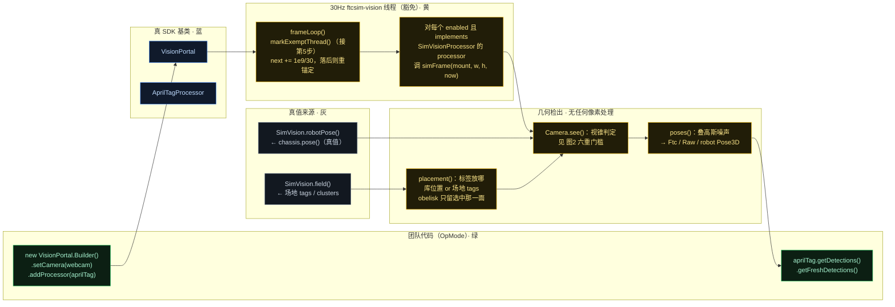
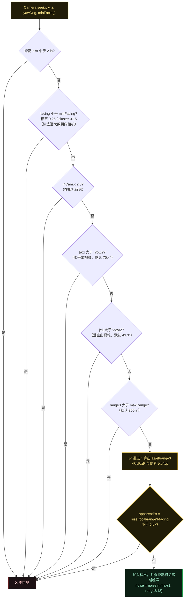
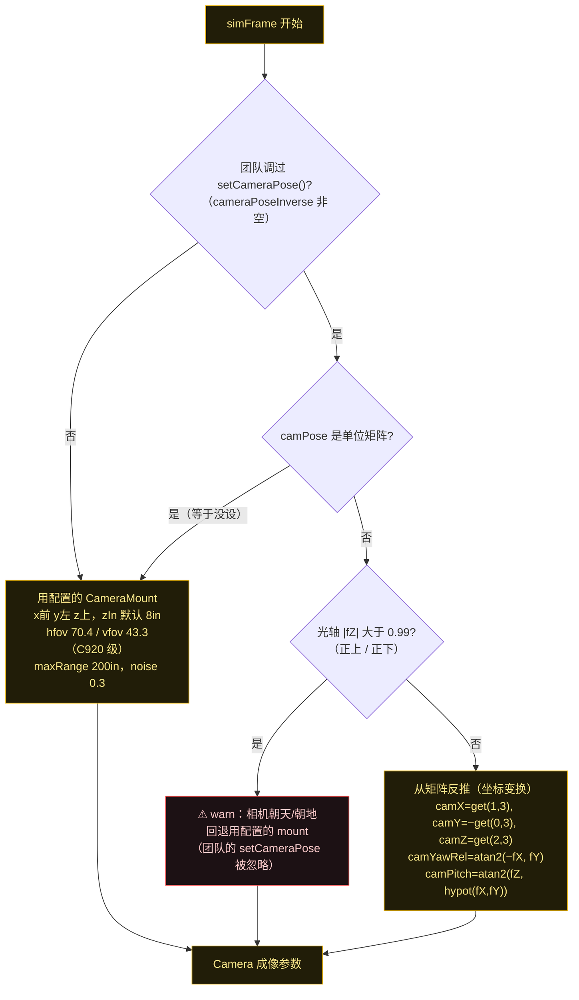
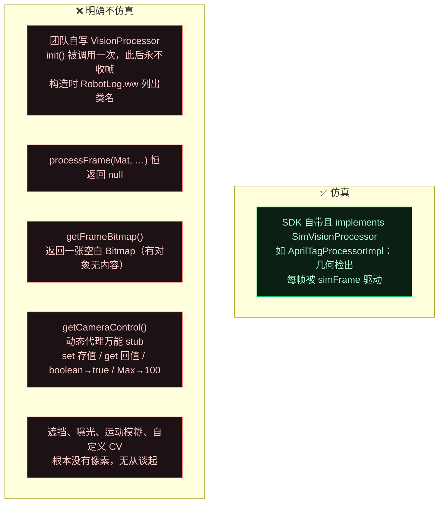

# FTCSim Vision（Phase 1 · 第 6 步：`VisionPortalImpl` → `AprilTagProcessorImpl`）

配色：**黄 = 模拟器实现**（ftcsim.* 及挂在 SDK 包名下的 shadow）· **蓝 = 真 SDK 基类**（`VisionPortal` / `AprilTagProcessor`）· **绿 = 团队代码** · **红 = 明确不仿真的边界** · **灰 = 真值来源**。

本步一句话结论：**没有摄像头**。30 Hz 的 `frameLoop` 只驱动实现了 `SimVisionProcessor` 的第一方 processor，检出是**纯几何 + 高斯噪声**算出来的；团队自写的 processor **会被 `init()` 一次，此后永不受帧**并会在构造时 warn 列出类名。

## 图 1：Vision 全链路

## 图 2：`Camera.see()` —— 一个标签到底凭什么看不见（return-null 链）

这张图用来解释"为什么某个 tag 检测不到"。**任一条件失败就返回 null**：

> 远处标签不是"变模糊"，而是**彻底消失**（丢进 6 px 门槛）。`Random` 种子固定为 11，所以同一段运行是可复现的。

## 图 3：相机到底装在哪（mount vs `setCameraPose`，含朝天防呆）

## 图 4：模拟器**不**仿真什么（团队自写 processor 的天花板）

> **这意味着什么**：FTC 里常见的"用 OpenCV 自己做颜色/形状识别"的代码，在 FTCSim 里会通过构造和初始化不报错，但**永远查不到任何结果**——这是设计上的诚实告知（warn 了），不是 bug。

## 三个容易忽略的细节

| 细节 | 说明 |
|---|---|
| **暂停时视觉仍在跑** | 视觉线程是豁免线程，不付 hub 时延也不过暂停门；但 `robotPose()` 被冻结，所以暂停期间 AprilTag 读数**保持不变也不消失** |
| **tag 的 +Z 指向 tag 内部** | 库 quaternion 变换出的 `VectorF(0,0,1)` 是"指向 tag 内"的法线，标签朝向取反方向：`yawDeg = degrees(atan2(−z.y, −z.x))` |
| **`getRobotPose()` 是"带噪声的真值"** | `Pose3D robot` = `robotPose()` 真值 + 高斯噪声，不是视觉推算出来的——所以用它做定位会比真实机器人乐观 |

## SDK 11 / 12 兼容（全靠反射）

静态初始化块里探测：优先找 SDK 12 的 `AprilTagSingleDetection` 带 `DistanceUnit` 的构造函数；找不到退回 SDK 11 的 `AprilTagDetection` 老签名。SDK 12 的 cluster API（`getAllClusters` / `AprilTagClusterMetadata` / `AprilTagClusterDetection`）同样用 `Class.forName` 探测，失败置 null 时整个 cluster 分支跳过。检出的 cluster 置信度 = **可见成员数 / 总成员数**，成员越多噪声除以 `sqrt(visible)` 越准。

## 源码证据

- `sim/src/main/java/org/firstinspires/ftc/vision/VisionPortalImpl.java:25-32（类注释/FPS）, 45-65（init + notSimulated warn）, 78-95（frameLoop）, 126-150（动态代理）, 155-158（空白 Bitmap）`
- `sim/src/main/java/org/firstinspires/ftc/vision/apriltag/AprilTagProcessorImpl.java:115-138（see 六重门槛）, 141-163（placement / tag +Z / obelisk）, 165-253（simFrame）, 200-202（6px + 噪声）, 51-80（SDK 11/12 反射）`
- `sim/src/main/java/ftcsim/vision/SimVision.java:17-33（真值上下文）`
- `sim/src/main/java/ftcsim/vision/CameraMount.java:5-10（默认参数）`

配套研究笔记：`notes/research/sim-physics-research-notes.md` 结论 24–27。
