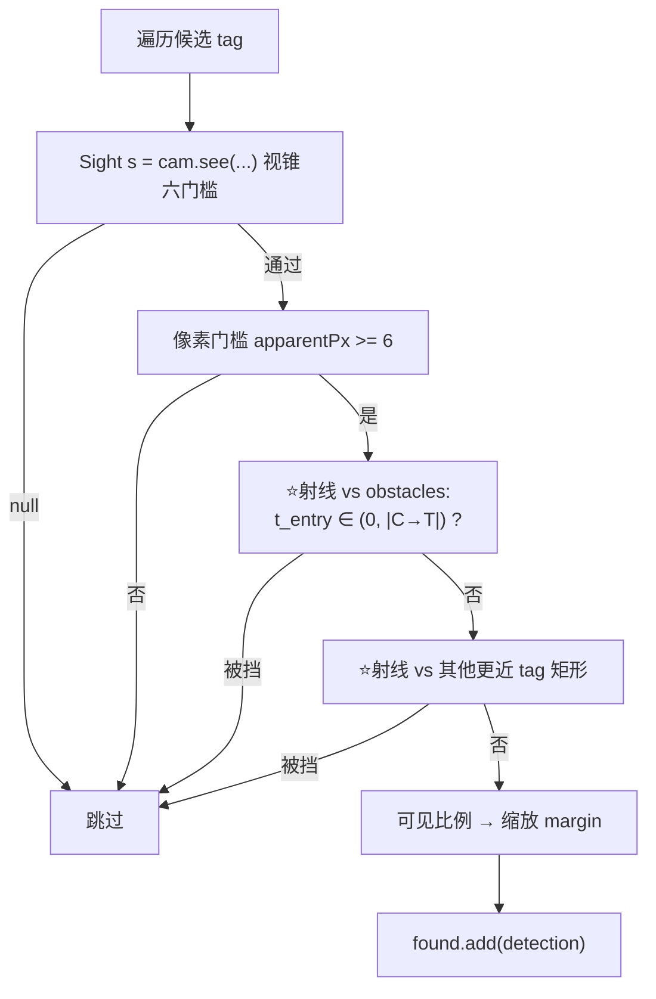
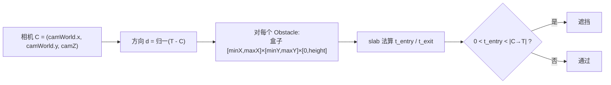
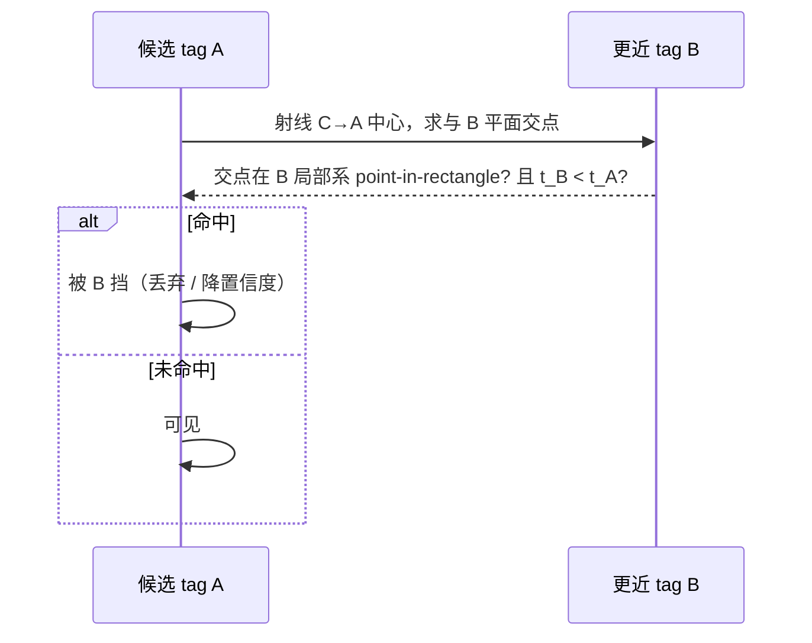

# AprilTag 遮挡判定（设计草案）

> 2026-10-24 基于源码 very thorough 探索。本篇是**设计草案**，尚未实现。当前 sim 的 AprilTag 检出**完全没有遮挡判定**——`docs/vision/01-vision.md` 图 4 的 NO5 已把它列为"明确不仿真"的边界。本文给出把遮挡判定落地的纯几何方案。

## 1. 现状：零遮挡判定

唯一的可见性判定在 `Camera.see(double x, double y, double z, double yawDeg, double minFacing)`（`AprilTagProcessorImpl.java:115-138`），其 `return null` 链只含视锥 + 朝向 + 距离门槛；`simFrame(...)`（`:165-253`）对每个 tag 调 `see()` → 6px 像素门槛 → 叠噪声 → 加检出，**中间没有任何"中间有没有东西挡着"的环节**。

在 vision 包内搜索 `obstacle` / `raycast` / `occlu` / `see(` 均零命中——`Field.Obstacle` 从没被 vision 包引用过。

哪些是简化 / 未实现：

| 项 | 现状 |
|---|---|
| **遮挡判定** | 完全未实现 |
| 投影 | 解析法 pinhole（无投影矩阵、无镜头畸变） |
| 朝向 | `facing = normal·(-rel/dist)` 余弦，正确（适用于平面 tag） |
| 近/远裁剪 | `dist<2in` / `range3>maxRange`（等效裁剪面，非 OpenGL 概念） |
| 噪声 | 仅高斯，无异常值 / 运动模糊 / 曝光 |
| 检出置信度 `margin` | `Math.max(5, 120 - range3/2)`（`:208`），确定性距离启发式，**不是**遮挡置信度 |
| Cluster 可见性 | `visible/total` 比例（`:228-234`），粗代理，未做射线 |

## 2. 实现遮挡所需的几何输入——当前代码都已具备

| 输入 | 是否具备 | 位置 / 证据 |
|---|---|---|
| 相机位姿（世界位置 + 朝向） | ✅ | `simFrame` 由 `SimVision.robotPose()`（`:166`）→ `camWorld/camYaw/camPitch/camZ`（`:185-187`）算出 |
| 每个候选 tag 的世界位姿 | ✅ | `placement()`（`:141-163`）→ x,y,z,yawDeg,sizeIn；`see()` 已算相机系 `xF/yF/zF`、像素 `txp/typ`（`:133-136`） |
| 场地结构（障碍物） | ✅ | `SimVision.field().obstacles`（Field.java:146），每个 `Obstacle` 是轴对齐盒 + 高度（`:18-26`） |
| 其他 tag 作为遮挡物 | ✅ | `tagLibrary.getAllTags()` / `field.tags`（带 yaw 和 size 的矩形平面） |
| CELL / cluster 盒作为遮挡物 | ✅（几何更细） | `Field.Cluster`（`:66-120`）、`CELL_PENT`/`pentagonSd`/`pentagonClosest`（Field.java:252-285） |
| 机器人外伸臂遮挡 | ❌ | `DeviceMount`（DeviceMount.java:22-93）描述关节/形状，但未装配成 vision 用的世界变换；`robotPose()` 仅 `Pose2` |

**结论**：tag-tag 和 障碍物-tag 两类遮挡所需的全部几何输入都已现成，缺的只是判定代码，以及"全部隐藏 vs 部分置信度"的策略选择。复用先例：`DistanceModel.rayToAabb(Vec2 o, Vec2 d, …)`（`:42-55`）已是 2D 射线–AABB slab 求交，`measureMm()`（`:25-39`）已用它对"围墙 + 所有 obstacles"做射线——只需扩成 3D（z 方向加 `[0, height]` 两个 slab）即可用于遮挡测试。

## 3. 设计要点（纯几何，无像素 / 深度缓冲）

因为没有像素 / 深度缓冲，遮挡必须**纯几何**判定。

### 3.1 障碍物遮挡（结构 AABB + 高度）

对通过视锥的候选 tag：
1. 取相机世界位置 `C=(camWorld.x, camWorld.y, camZ)`，目标 tag 中心 `T`。
2. 对每个 `Obstacle`（minX,minY,maxX,maxY,height）：做 **3D 射线–AABB slab 求交**（把 `rayToAabb` 从 2D 扩到 3D，z 限制在 `[0, height]`，因为盒子从地面起）。
3. 若某 obstacle 的进入参数 `t_entry ∈ (0, |C→T|)`（即在 tag 之前进入盒子），则该 tag 被遮挡。

### 3.2 Tag-to-tag 遮挡（矩形平面）

tag 是中心 (x,y,z)、法线=朝向（由 yawDeg 得）、边长=sizeIn 的薄矩形：
1. 对候选 tag A，向 A 中心发射线；
2. 对每个**更近的** tag B，求射线与 B 的矩形平面求交，判断交点是否落在 B 的边界内（转到 B 的局部系做 point-in-rectangle）且 `t_B < t_A`；
3. 命中即 A 被 B 挡。

### 3.3 部分遮挡 / 置信度策略（建议）

- 单射线（只打中心）只能判断"中心被挡"；部分遮挡需采样 tag 面（4 角 + 中心，或网格），统计可见比例。
- 复用现有语义：tag 可像 cluster 那样给出"可见角点数 / 总采样点数"，低于阈值则丢，否则把 `margin`（`:208`）按可见比例缩放作为置信度——**不破坏 SDK 的 `AprilTagDetection` 接口**，只是把 margin 从固定启发式改成"被遮挡程度"的代理。

**关键设计决策（写实现前需拍板）**
1. 二进制（隐藏 / 可见）还是连续（可见比例→置信度）？→ 建议后者，复用 `margin`。
2. 采样粒度：4 角 + 中心（便宜、够用）还是网格（精确）？
3. 是否对 cluster 也做（对成员射线 + 原点射线）？cluster 已有成员比例，可替换粗代理。
4. 是否纳入机器人外伸臂遮挡？需把 `DeviceMount` 装配成世界盒——属更大工作量，列为 Phase 2。
5. 性能：30 Hz，tag 数十个、obstacle 约 6–8 个，复杂度 O(tag×(obstacle+tag))，可忽略。

## 4. 插入点（simFrame 主循环）

> 遮挡应插在 `cam.see()` 通过 + 像素门槛（`:200-201`）之后、`found.add(...)`（`:213`）之前；cluster 分支的 `visible` 统计（`:228-234`）与原点 `see`（`:235`）处，可改为真射线可见性。

## 5. 3D 射线–AABB 求交（扩展 rayToAabb）

## 6. Tag-to-tag 矩形求交

## 7. 能力矩阵（现状 vs 目标）

| 能力 | 现状 | 落地难度 |
|---|---|---|
| tag-tag 遮挡 | 未实现 | 可立即做（几何现成） |
| 障碍物遮挡 | 未实现 | 可立即做（扩展 rayToAabb） |
| 机器人臂自遮挡 | 未建模 | Phase 2（需 DeviceMount→世界盒） |

## 8. 代码引用（改动 / 新增点）

- `AprilTagProcessorImpl.java`
  - `Camera.see(...)` `:115-138` —— 视锥六门槛，**无遮挡**；
  - `simFrame(...)` `:165-253` —— 主循环，遮挡插在 `:198`（`see`）通过 + `:200-201`（像素门槛）之后、`:213`（`found.add`）之前；
  - `margin` `:208` —— ⭐ 建议改造成"遮挡置信度"载体；
  - `random = new Random(11)` `:45` —— 复现性（遮挡判定也应走同一随机源，或确定性）；
  - ⭐ **新增**：`field().obstacles` 读取 + 3D 射线–AABB / 矩形平面求交（新增 `Occlusion` 工具类，或放 `Camera` 内）。
- `DistanceModel.java`（复用，**不改**）：`rayToAabb(...)` `:42-55`（复制/扩展为 3D，加 z/height slab）、`measureMm()` `:25-39`（射线对围墙 + obstacles 的现有范例）。
- `Field.java`：`Obstacle` `:18-26`、`obstacles` `:146`、`HALF_SIZE_IN` `:15`、`AprilTag` `:50-59`、`Cluster` `:66-120`、`pentagonSd/Closest` `:260-285`、`:15`。
- `CameraMount.java` `:5-10`（hfov/vfov/maxRange/noise 默认）、`:12-17` copy。
- `SimVision.java` `robotPose():26`、`field():27`、`install():25`。
- `VisionPortalImpl.java`：`frameLoop()` `:78-95`（尤其 `:86` 调 `simFrame(mount, w, h, now)`）、`FPS=30.0` `:32`。

## 9. 坐标 / 帧约定（务必保持一致）

- 机器人系：x 前、y 左、z 上（`CameraMount.java:5`、`DeviceMount.java:23`）。
- 场地系：原点中心，+Y 红墙→蓝墙，+X 观众，+Z 上，heading 从 +X 逆时针（`Field.java:10-13`）。
- 相机内参：`fx/fy`（焦距，`:86`）、`(cx,cy)=(w/2,h/2)`（`:136`）；外参：`cameraPoseInverse`（OpenGLMatrix，`:85`）或 mount 反推（`:169-183`）。
- 相机系（see 内）：`inCam.x`=相机前向分量，`xF=-inCam.y`（左），`yF`=沿光轴前，`zF`=上（`:133-136`）。
